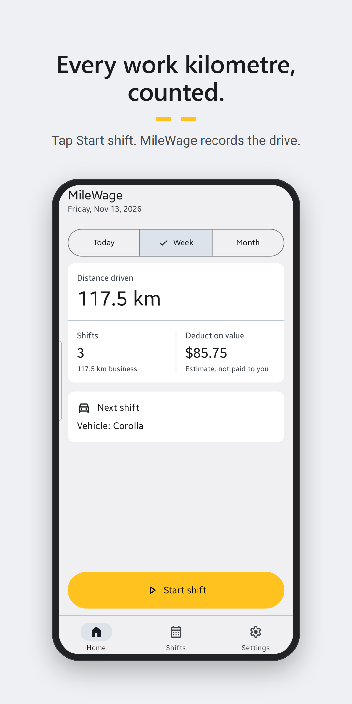
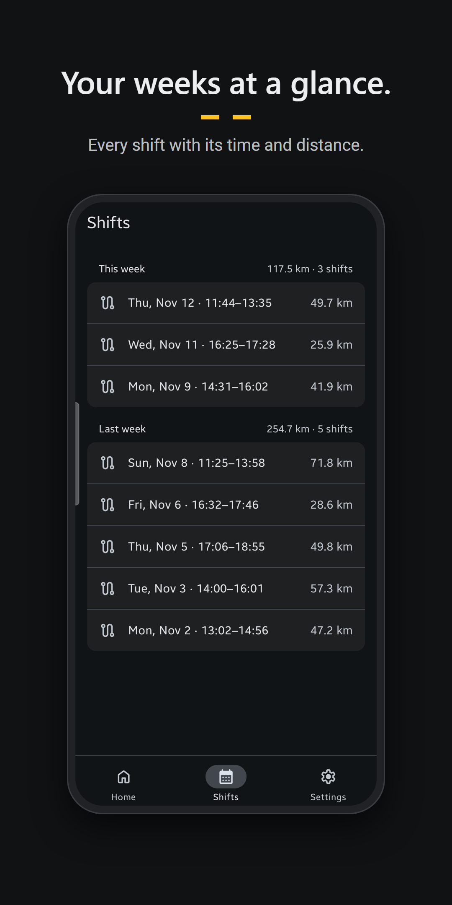
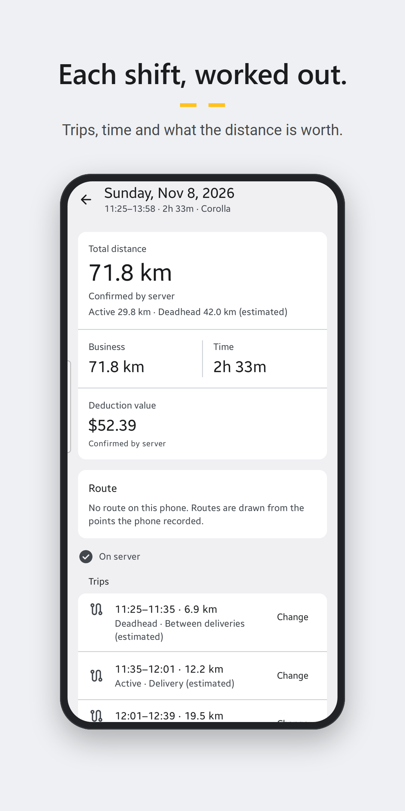
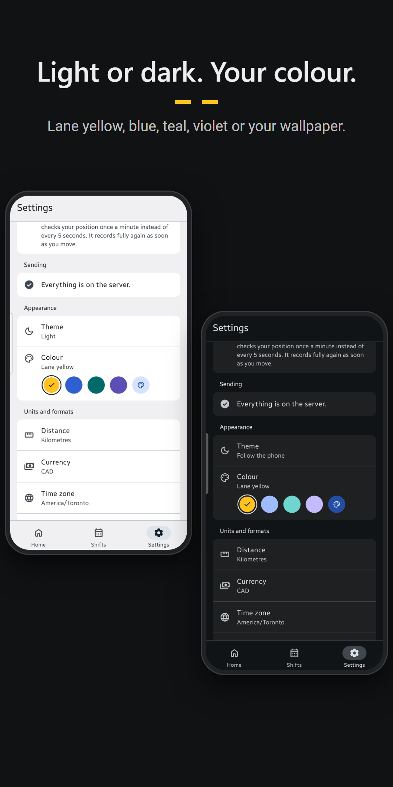

<p align="center">
  <picture>
    <source media="(prefers-color-scheme: dark)" srcset="branding/coin-thin/lockup-reverse.svg" />
    
  </picture>
</p>

<p align="center">
  <strong>Self-hosted mileage tracking for gig riders and drivers.</strong><br />
  Your phone records the shift. Your own server keeps the miles and the money.
</p>

<p align="center">
  <a href="LICENSE"></a>
  <a href="https://github.com/raiz-toff/Milewage/releases/latest"></a>
  <a href="https://github.com/raiz-toff/Milewage/actions/workflows/verify.yml"></a>
</p>

<p align="center"></p>

## What it is

Delivery and ride-hail drivers need a mileage log their accountant will accept, and a view of what a shift really earned. The apps that do this keep the location history of every working day on someone else's servers.

MileWage runs on a machine you own, a home server or a Raspberry Pi, and the phone reaches it over your Tailscale network. There is one driver per server, and nothing leaves your network.

## What it does

- **Records the shift.** The Android app tracks GPS while you work, keeps going with the screen off, and works offline for weeks. It needs nothing from Google.
- **Counts the miles.** Shifts, trips and stops come from the track, with active and deadhead miles as an estimate.
- **Keeps the money.** Earnings, expenses with receipt photos, vehicles, odometer readings, parking and tolls.
- **Helps at tax time.** Mileage deductions for Canada, the United States and Great Britain, or your own rate, and a PDF report and CSV files for your accountant.
- **Looks after the data.** Nightly encrypted backups with a recovery key only you hold.

**Status.** MileWage is a complete build that has not had its field test yet: no real shift on the road, and no run over a real Tailscale network. What is still unverified is in [`CHANGELOG.md`](CHANGELOG.md) and [`TODO.md`](TODO.md).

## On the phone

<p align="center">
  
  
  
  
</p>

Light and dark follow the phone, with Lane yellow or a colour of your choice. These are the Google Play screenshots; all seven are in [`apps/android/play/`](apps/android/play/listings/en-US/phone-screenshots/).

## Get started

**The server.** You need a host with Docker and a Tailscale account. Nothing is opened on your router.

```bash
git clone https://github.com/raiz-toff/Milewage.git milewage && cd milewage
infra/install.sh
```

Open the web app, create the owner account and **write down the recovery key** it shows. The server cannot show it again.

**The phone.** Android 8.0 or later. Install `milewage-<version>.apk` from the [latest release](https://github.com/raiz-toff/Milewage/releases/latest), tap "I have a server" and scan the QR code from the web's Devices page.

The full steps are in the [install guide](infra/docs/install.md) and [Getting started](docs/help/getting-started.md).

## Documentation

| For                 | Read                                                                                                                            |
| ------------------- | ------------------------------------------------------------------------------------------------------------------------------- |
| Drivers             | [`docs/help/`](docs/help/README.md): shifts, miles, expenses, tax, backups and troubleshooting. Also in the web app under Help. |
| Running a server    | [Install](infra/docs/install.md), [upgrade](infra/docs/upgrade.md), [configuration](infra/docs/configuration.md).               |
| Changing the code   | [`docs/development.md`](docs/development.md) and [`CONTRIBUTING.md`](CONTRIBUTING.md).                                          |
| What changed        | [`CHANGELOG.md`](CHANGELOG.md)                                                                                                  |
| Reporting a problem | [`SECURITY.md`](SECURITY.md) for vulnerabilities, [Issues](https://github.com/raiz-toff/Milewage/issues) for everything else.   |
| Everything else     | [`docs/`](docs/README.md)                                                                                                       |

## The story

MileWage began as a Google Sheet of delivery weeks. It became a tracker called Macadam, then [Comma](https://github.com/raiz-toff/Comma), and then this. Read [the story behind MileWage](docs/story.md).

## Licence

MileWage is free software under the GNU Affero General Public License, version 3 ([`LICENSE`](LICENSE)). Copyright (C) 2026 rajkumar. If you run a changed MileWage for others, the AGPL asks you to offer them your changes.
