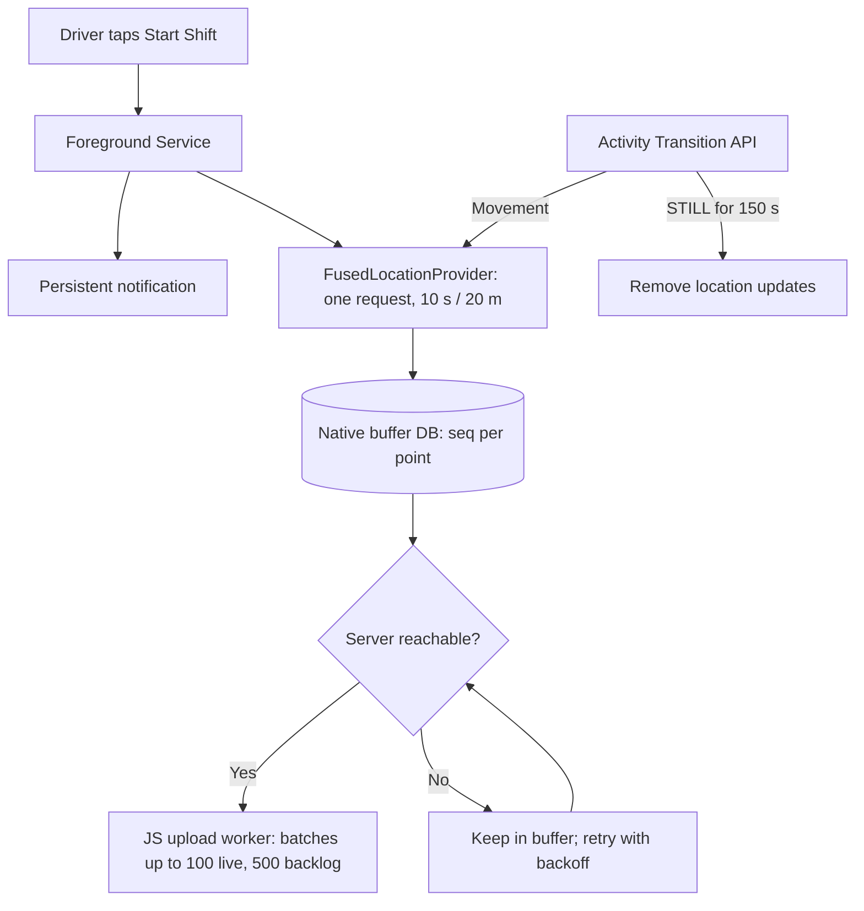

# 02 — Mobile Telemetry & Android Architecture Plan

**Lead Agent:** Agent 1 (Mobile & Android Systems Specialist)  
**Auditor:** Agent 5 (Anti-Slop Auditor)  
**Status:** DRAFT SPECIFICATION (Gate 1 In Progress)  
**Build note (2026-11-08):** built; what was done and what differs is in [`progress.md`](./progress.md). Gate 1 was approved on 2026-11-03 (`06` section 6, [`DECISIONS.md`](../../DECISIONS.md)); this status line was not updated after that.  
**Parent:** [`plans/milewage/README.md`](./README.md)

---

## 1. Objectives & Hardware Budget

The MileWage mobile app is built with Expo / React Native (TypeScript), Android first (item 1.6). Sections below describe Android system behaviour that the app must reach through `expo-location` background tasks or a small native module, to be settled in Gate 2. It is a delivery-tracking companion and a working local app (decision 1.5a): it records trips and deliveries, runs the shared processing engine at shift end (`14`) so totals and routes show offline for weeks, keeps its raw points and results until the server confirms them (`15`), and lets the driver add details at the end. The server is the final source of truth. It must operate under strict, measurable budgets:
- **Battery Impact**: Less than **3.5% battery drain per hour** of active GPS tracking.
- **Data Reliability**: **0% dropped breadcrumbs** when driving at highway speeds (up to 130 km/h) through cellular dead zones.
- **Local Storage Overhead**: at most about **12 MB** with a year of history fully synced, plus about **0.35 MB per unsynced shift** (about 20 MB after 4 weeks offline, 37 MB after 12; budgets and retention in `15` §3). These are upper-bound estimates until Spike A measures them.
- **RAM Footprint**: Under **60 MB resident memory** on Android devices.

---

## 2. Background Execution & OEM Defense Architecture

Decisions below follow [`09`](./09-background-gps-decision.md) (a local Kotlin native module, copied from Comma and trimmed), pending the Human approvals listed in `09` §10. The phone reads the server's `modules` flags (`08` §16.1): with `tracking` off it starts no tracker and uploads nothing, and with `deliveries` off it hides delivery buttons.



### 2.1 The Foreground Service Standard
- Declare `android:foregroundServiceType="location"`.
- Continuous persistent notification showing:
  - Real-time shift duration and odometer.
  - No order or stop buttons or counts (decision 1.5b). With stops on, nothing about stops is shown during the shift.
  - Sync indicator (Green = nothing pending, Yellow = pending and the server is unreachable or syncing, Red = needs attention: revoked, wrong server, parked items, storage full) with the "Not yet on server" counts of `15` §4.3.
- During onboarding, open the system battery-optimization settings screen and walk the driver through the OEM autostart steps (Samsung One UI, Xiaomi HyperOS, OnePlus OxygenOS). The app does not declare `REQUEST_IGNORE_BATTERY_OPTIMIZATIONS` unless Play policy is confirmed (`09` §5.3).

### 2.2 Location Sampling (proposed in `09` §6)

Continuous high-frequency GPS drains a battery in 3 to 4 hours, so the radio is gated by movement. One location request plus activity gating replaces the earlier four-tier speed table, which had no evidence behind it. Starting values, tuned by Spike A:

| State | Trigger | Request |
|---|---|---|
| **Moving** | Activity Transition = IN_VEHICLE / ON_BICYCLE / ON_FOOT | High accuracy, interval 10 s, minimum displacement 20 m, `maxUpdateDelay` 30 s (Comma's proven values, `14` §4; 5 s / 10 m is experiment E1) |
| **Still** | `STILL` confirmed for 150 s | Remove location updates (GPS radio off); resume on movement |

The native service **records every fix** with its accuracy and speed and applies **no distance filter**. The stationary gate (20 m from the last accepted fix), the spike cut (42 m/s) and the accuracy filter (50 m) live in the shared engine (`14` §5), so there is one implementation to test. The speed tiers and the 60 s stationary heartbeat are cut. A tier returns only if Spike A shows the battery or accuracy budget is missed.

---

## 3. Offline Buffering & Upload Queue

To handle cellular dead zones (rural highways, underground parking structures, elevator shafts), points are written atomically to a local SQLite buffer before any network transmission is attempted.

### 3.1 Local Tables (native-owned buffer database)

The buffer mirrors the wire format in `08` §5 and the server columns in `07` §2.5, so nothing is converted on upload.

```sql
CREATE TABLE telemetry_buffer (
    seq INTEGER PRIMARY KEY AUTOINCREMENT,   -- device-assigned, strictly increasing, never reused
    shift_client_id TEXT NOT NULL,           -- UUID of the shift this point belongs to
    recorded_at INTEGER NOT NULL,            -- UTC epoch ms
    lat_e7 INTEGER NOT NULL,
    lon_e7 INTEGER NOT NULL,
    accuracy_m INTEGER NOT NULL,
    speed_dmps INTEGER,
    bearing_deg INTEGER,
    altitude_m INTEGER,
    sync_status TEXT NOT NULL DEFAULT 'PENDING',  -- PENDING, UPLOADED
    uploaded_at INTEGER                      -- epoch ms of the server acknowledgement; NULL while PENDING (15 §2.1)
);
CREATE INDEX idx_telemetry_sync ON telemetry_buffer(sync_status, seq);
CREATE INDEX idx_telemetry_evict ON telemetry_buffer(sync_status, uploaded_at);

-- Points the server permanently refused (08 §4.3). Same columns plus a reason; kept 30 days for diagnostics.
CREATE TABLE telemetry_quarantine (
    seq INTEGER PRIMARY KEY,
    shift_client_id TEXT NOT NULL,
    recorded_at INTEGER NOT NULL,
    lat_e7 INTEGER NOT NULL,
    lon_e7 INTEGER NOT NULL,
    reason TEXT NOT NULL,
    quarantined_at INTEGER NOT NULL
);
```

Battery level and per-point delivery IDs are not stored: stops and the estimated active/deadhead split are derived from the points by the shared engine (`14` §6, `07` §2.8).

### 3.2 Sync Protocol & Backpressure
The full contract is `08` §4 and §5. In short:
- **Batching**: Up to **100 points** (live) or **500 points** (backlog mode, `15` §6.3) per gzip-compressed `POST /api/v1/telemetry/batch`, about every 60 s while a shift is active (the server may shorten this to 15 s while the web map is open).
- **Acknowledgement**: A confirmed point is marked `UPLOADED` with `uploaded_at` and kept for `LOCAL_RAW_DAYS` (default 14), then evicted; a `PENDING` point is **never** deleted (`15` §3.2). The phone also keeps its own shift results, trips and simplified route as a local read copy (`15` §2.2); the server stays the final source of truth and its numbers win on any difference (`15` §7).
- **Exponential Backoff**: 2s &rarr; 4s &rarr; 8s &rarr; 16s &rarr; 32s &rarr; 60s with jitter, reset on any success.

---

## 4. Starting a Shift (Auto-Start Is Not in v1)

Android 12+ blocks starting a foreground service from the background, and no exemption for a plain Bluetooth receiver was found (`09` E8). So in v1 **the driver taps Start Shift**.
- **v1.1 candidate:** a Bluetooth-connect or IN_VEHICLE event posts a notification, *"Connected to car. Start shift?"*; the tap starts the service from a user-visible state.
- **Later, only if the Human asks for hands-free start:** `CompanionDeviceManager` pairing (`09` §5.5).
- The "auto-stop / park reminder" idea is also a v1.1 notification candidate, not v1.

---

## 5. Adversarial Review & Anti-Slop Audit (Agent 5)

> [!CAUTION] Critical Audit Findings & Mitigations
> 1. **Risk of Background Termination on Android 14+**:
>    - *Audit Finding*: Android 14 introduces stricter foreground service timeouts and policy restrictions for location services.
>    - *Mitigation*: Service must implement `START_STICKY`, declare proper service types in the Android Manifest, and handle `onTaskRemoved` to ensure reliable recovery.
> 2. **GPS Jitter at Rest (Phantom Mileage)**:
>    - *Audit Finding*: When a vehicle is parked for 45 minutes, GPS noise will generate "phantom miles" that corrupt tax logs and artificially inflate deductible mileage.
>    - *Mitigation*: The shared engine's stationary gate: a fix less than 20 m from the last accepted fix adds no distance and does not move the anchor (`14` §5.3, Comma's proven rule). It replaces the earlier 1.5 km/h / 12 m dwell collapse. Measured in Spike A test A5 and experiment E3.
> 3. **Over-Engineering Warning**:
>    - *Audit Finding*: Raw NMEA / GNSS satellite constellation tracking is unnecessary and doubles battery consumption.
>    - *Mitigation*: Stick strictly to Google Play Services `FusedLocationProviderClient`. A `LocationManager` fallback for de-Googled devices is deferred (`09` §5.7); those phones show a clear "unsupported" message in v1 unless the Human decides otherwise.

