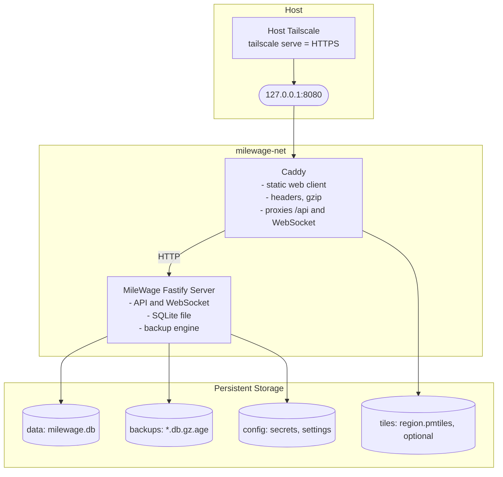

# 03 — Self-Hosted Docker & Backend Architecture Plan

**Lead Agent:** Agent 2 (Self-Hosted Docker & Backend Architect)  
**Auditor:** Agent 5 (Anti-Slop Auditor)  
**Status:** DRAFT SPECIFICATION (Gate 1 In Progress — stack decided 2026-11-03, item 1.3)  
**Parent:** [`plans/milewage/README.md`](./README.md)

---

## 1. Design Constraints & Hardware Budget

The self-hosted MileWage server must be lightweight, robust, and zero-maintenance:
- **RAM Footprint**: Under **150 MB total RAM** for the entire stack (API, database, reverse proxy).
- **CPU Idle**: Less than **0.5% CPU utilization** during periods without active incoming telemetry.
- **Hardware Compatibility**: Standard x86_64 VPS ($4-6/month from Hetzner/Linode/DigitalOcean) AND ARM64 (Raspberry Pi 4/5, Oracle Cloud Free Tier).
- **Deployment Complexity**: 100% turnkey via `docker compose up -d`.

---

## 2. Technology Stack (DECIDED, item 1.3)

```
+-------------------------------------------------------------------------------+
| Layer             | Selected Stack          | Justification                   |
+-------------------+-------------------------+---------------------------------+
| Runtime / API     | Node.js 22 LTS          | Same language as the Expo phone |
|                   | + Fastify + TypeScript  | app and the web client: shared  |
|                   | + Drizzle ORM           | API types, validation, money    |
|                   |                         | and mileage logic.              |
+-------------------+-------------------------+---------------------------------+
| Database          | SQLite (single file)    | One driver per instance (1.4),  |
|                   |                         | no DB daemon, backup = copy a   |
|                   |                         | file. Distance, simplification  |
|                   |                         | and GeoJSON done in app code.   |
+-------------------+-------------------------+---------------------------------+
| Reverse Proxy     | Caddy 2                 | Static files, gzip, headers,    |
|                   | (Alpine image)          | proxy. HTTPS comes from host    |
|                   |                         | Tailscale (home lab); Let's     |
|                   |                         | Encrypt in public mode (v1.1).  |
+-------------------+-------------------------+---------------------------------+
| Web Frontend      | Vite + Tailwind CSS     | Thin client served as static    |
|                   | + MapLibre GL JS        | files by the API; no local data |
|                   |                         | cache (1.5).                    |
+-------------------+-------------------------+---------------------------------+
```

**Modularity:** the server is organised into toggleable modules (core, devices, tracking, replay, live, stops, exporters, country packs, backup), each with a route group, a config switch and a removal path. See `08` §16 and README §1.3.

**ESM toolchain (S0):** the backup encryption package `age-encryption` is ESM-only and pre-1.0, so the server is built as ESM and the exact version is pinned (`10` §4).

**Monorepo:** server, phone app and web client live in the MileWage repo and share one `packages/shared` module (API request/response types, validation schemas, mileage and money helpers). Comma code is copied in once and re-verified; there is no link back to `commaApp` (1.2).

*Alternatives considered:*
- *Go + SQLite: about 45 MB less RAM and a single binary, but loses shared types and logic with the Expo phone app and the web client. Rejected because that sharing is worth more than the RAM saved.*
- *PostgreSQL + PostGIS: strong spatial queries and many-user concurrency, neither needed for one driver per instance, and it is the largest RAM cost in the stack. Rejected. Drizzle keeps a later move to Postgres open if multi-user arrives (every table carries `user_id`).*

**Open to verify in Gate 3 (Spike B):** SQLite write throughput under the telemetry batch load, using WAL mode, on the smallest target VPS and a Raspberry Pi.

---

## 3. Docker Compose Topology

Two containers, as decided. Operational detail (networking, secrets, backups, upgrades) is specified in [`10`](./10-backup-restore-and-ops-spec.md); this section is the summary.



### Reference `docker-compose.yml` (home-lab mode)
```yaml
services:
  caddy:
    image: caddy:2-alpine           # pinned to a digest or minor tag in the release file
    restart: unless-stopped
    ports:
      - "127.0.0.1:8080:8080"       # loopback only; host Tailscale terminates HTTPS
    volumes:
      - ./Caddyfile:/etc/caddy/Caddyfile:ro
      - tiles:/srv/tiles:ro
      - caddy_data:/data
      - caddy_config:/config
    depends_on:
      api:
        condition: service_healthy

  api:
    image: ghcr.io/milewage/server:1.0.0   # always an explicit version, never :latest
    restart: unless-stopped
    environment:
      - NODE_ENV=production
      - MILEWAGE_MODE=home-lab
    volumes:
      - data:/app/data
      - backups:/app/backups
      - config:/app/config
    healthcheck:
      test: ["CMD", "wget", "-qO-", "http://127.0.0.1:3000/healthz"]
      interval: 30s
      timeout: 5s
      retries: 3
    # no published ports; only Caddy reaches the API on milewage-net

volumes:
  data:
  backups:
  config:
  tiles:
  caddy_data:
  caddy_config:
```

There is no database container and no secret in the environment: secrets are generated on first start (`10` §9). In public mode (v1.1) the same containers run with a different Caddyfile that listens on 80/443 for a driver-owned domain.

---

## 4. API, Pairing and Deployment Paths

### 4.1 API contract
The API is specified in [`08`](./08-api-spec.md), including all routes, the offline upload contract and the OpenAPI 3.1 document. `03` no longer lists routes, so the two cannot disagree.

### 4.2 Device pairing
QR code with the server URL and a one-time token; the phone exchanges it for a revocable device credential (`08` §2.4).

### 4.3 Deployment paths (home lab first, item 1.7)
- **Primary:** Home server or Raspberry Pi running `docker compose up -d`, reached from the phone through **Tailscale** on the host (`tailscale serve`, no router ports opened). Must be tested on ARM64 and x86_64.
- **Also acceptable:** A Cloudflare Tunnel pointed at `127.0.0.1:8080`, or a reverse proxy the owner already runs.
- **Later (v1.1):** VPS with a public domain and Caddy auto-TLS.
- **Unsupported:** local-IP-only (fails once the driver leaves home Wi-Fi), router port forwarding, and self-signed `tls internal` (the phone would need to trust a custom CA).

---

## 5. Backups & Disaster Recovery

The server holds the only copy of the data (1.5). The full specification is [`10`](./10-backup-restore-and-ops-spec.md): SQLite online-backup API, verified on write, gzip + `age` encrypted (recovery key shown once and never stored on the server), 7 daily / 4 weekly / 12 monthly plus pre-migration and pre-restore copies, download button and documented Syncthing/rsync for off-site, and a restore that aborts before touching live data on any failed check.

```bash
docker compose exec api milewage-cli restore --file=/app/backups/milewage-2026-11-01.db.gz.age
```

---

## 6. Adversarial Review & Anti-Slop Audit (Agent 5)

> [!CAUTION] Critical Audit Findings & Mitigations
> 1. **SQLite Write Contention**: a telemetry batch writer and a dashboard reader can block each other on default settings. Mitigation: WAL mode, one write connection, batched transactions, verified in Spike B (`10` §15).
> 2. **Telemetry growth**: raw GPS at one point per second is about 380 MB per driver per year, not the 10 GB once assumed; permanent growth is about 11 MB per year (`07` §5). Raw points are kept 90 days by default and then replaced by a route archive after the shift is finalized (`07` §4).
> 3. **Single copy of tax records**: with no local-first copy, a lost disk loses the records. Mitigation: verified nightly encrypted backups on by default, a persistent off-site reminder in the web UI, and a restore drill in Spike B (`10`).
> 4. **Reachability and TLS**: the phone must reach the server while driving. Mitigation: Tailscale-first home lab; unsupported paths are listed in §4.3.
> 5. **Container count**: two containers is a deliberate choice (Caddy gives one place for static files, headers and the later public-mode TLS). It costs about 15 MB idle (`10` §14).
