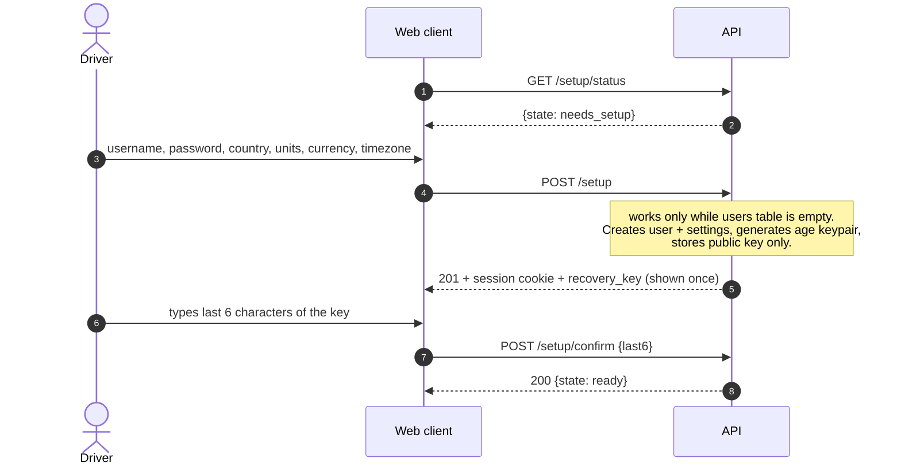
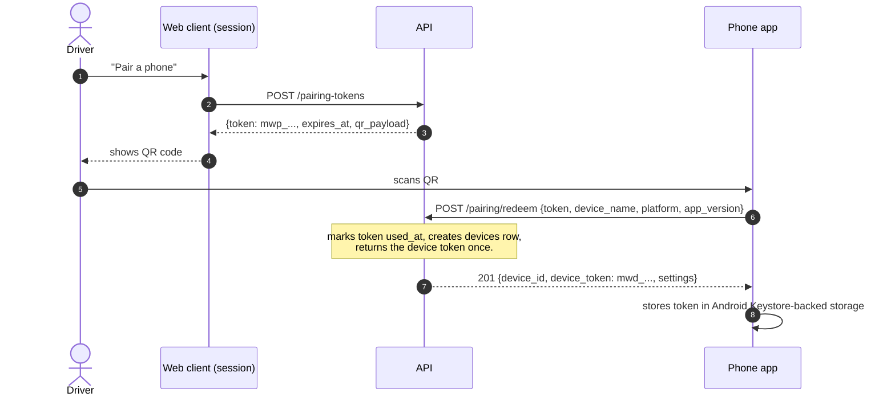

# 08 — API Specification (`/api/v1`)

**Lead Agent:** Agent 2 (Self-Hosted Docker & Backend Architect)  
**Auditor:** Agent 5 (Anti-Slop Auditor)  
**Status:** DRAFT SPECIFICATION (Gate 2) — decisions made, awaiting Human sign-off  
**Parent:** [`plans/milewage/README.md`](./README.md)  
**Inputs:** schema in [`07`](./07-database-schema-spec.md), phone engine in [`09`](./09-background-gps-decision.md), operations in [`10`](./10-backup-restore-and-ops-spec.md), exports in [`04`](./04-data-standards-and-handovers-plan.md), phone buffer in [`02`](./02-mobile-architecture-plan.md), shared processing engine in [`14`](./14-phone-processing-spec.md), phone storage and sync in [`15`](./15-offline-storage-and-sync-spec.md). Updated 2026-11-04 for decision 1.5a (§4.4, §6a, the `sync` module in §16) and decision 1.5b (no phone delivery routes; the `stops` module replaces `deliveries`: stops are auto-detected, labelled only on the web, toggled by `settings.stops_enabled`). Updated 2026-11-04 for decision 1.5c: the `diagnostics` and `capture` modules (§16.2, spec in [`16`](./16-diagnostics-and-telemetry-spec.md)), 12 operations in 8 paths, and the diagnostics fields of `Settings`.

This document is a specification, not code. The OpenAPI document in §13 is the contract the Fastify routes, the shared TypeScript types and the phone's upload worker must all be generated from or checked against. Where this document disagrees with `02` or `03`, this document wins and §14 lists the edits those files need. The API is organised into toggleable modules per the Modularity Rule in README §1.3; §16 lists them.

---

## 1. Conventions

| Topic | Rule |
|---|---|
| Base path | `/api/v1`. Two routes live outside it: `GET /healthz` (`10` §11.1) and the WebSocket upgrade at `GET /api/v1/live`. |
| Transport | HTTPS from the phone's point of view (Tailscale `serve` or Caddy, `10` §8). Caddy to API is plain HTTP on the Docker network. HTTP/1.1 is enough; no HTTP/2-specific features are used. |
| Format | JSON (`application/json`), UTF-8, `snake_case` field names. Errors are `application/problem+json`. **No protobuf, no gRPC** (`00` listed them as options): a driver produces about 1 point per 3 s, and gzip-compressed JSON is a few KB per batch. |
| Units and shapes | Exactly the storage conventions in `07` §1: timestamps are UTC epoch **milliseconds** in fields ending `_at`; distances are integer **metres** (`*_m`); money is integer **cents** (`*_cents`); coordinates are integer degrees × 10⁷ (`lat_e7`, `lon_e7`); speed is decimetres per second (`speed_dmps`). The API never converts to km, miles or decimal degrees. Display conversion is the client's job, using `GET /settings`. |
| IDs | Responses carry the server integer `id`. Rows the phone can create offline (`shifts` and manual `trips`) also carry `client_id` (UUID v4). |
| `{ref}` path parameter | Wherever a shift appears in a path, `{ref}` accepts **either** the integer `id` **or** the UUID `client_id`, told apart by shape. The phone only ever knows the UUID until its create call is acknowledged, so it can address the row without a lookup. |
| `user_id` | Never accepted in any request body or query. It always comes from the authenticated principal (`07` audit item 3). |
| Unknown fields | Servers and clients **ignore** unknown response fields; the server **rejects** unknown request fields with `422` so typos do not silently drop data. |
| Dates in queries | `from` / `to` are local calendar dates `YYYY-MM-DD` in `settings.timezone`, inclusive, matched against `shifts.local_date`. |
| Caching | Every `/api` response carries `Cache-Control: no-store`. |

---

## 2. Authentication and Pairing

### 2.1 Principals

| Principal | Credential | Storage on server | Used by |
|---|---|---|---|
| **Web session** | Cookie `mw_session`: opaque 256-bit random value, `HttpOnly; Secure; SameSite=Strict; Path=/`. Sliding 30-day expiry. | SHA-256 hash in a session table (see §14 fix F4). | The web client. |
| **Device** | `Authorization: Bearer mwd_<43 base64url chars>` (256-bit random, `mwd_` prefix so secret scanners can find a leaked one). No expiry; valid until revoked. | SHA-256 hash in `devices.token_hash` (`07` §2.1). Plaintext never stored. | The phone. |
| **Pairing token** | `mwp_<43 chars>`, one-time, expires in 10 minutes. | SHA-256 hash in `pairing_tokens.token_hash`. | The QR code only. |

Device credentials are opaque rather than JWTs so that revocation is instant (`10` §9). `devices.last_seen_at` is updated on any authenticated request, at most once per minute.

### 2.2 Scopes

A device is deliberately less powerful than a web session. A stolen unlocked phone must not be able to download years of home and work locations.

| Capability | Web session | Device |
|---|---|---|
| Create/end/edit shifts, odometer, trips, telemetry upload | Yes | Yes |
| Read shifts, trips, route; `GET /sync/changes` | Yes, all history | **Only rows whose shift started within the last 14 days, or that this device wrote to within the last 14 days** (`shifts.device_touched_at`, `07`; so a phone that uploads a 3-week-old shift can read it back to reconcile) |
| `GET /settings`, `GET /vehicles` | Yes | Yes (read only) |
| Read stops; label or clear a stop's label | Yes (stops module on) | **No** (decision 1.5b: the phone has no stop or order UI) |
| Change settings, vehicles, password; finalize, recalculate or purge shifts | Yes | No |
| Exports, backups, devices, pairing tokens, system status, summary, live WebSocket | Yes | No |
| Send diagnostics events and capture fixes (`16`) | Web errors only | **Yes** (its own phone events and fixes) |
| Read diagnostics events, health, bundle; manage capture sessions, replay, annotations | Yes | No |

A device calling a web-only route gets `403 scope_forbidden`.

### 2.3 First-run setup



Until `/setup/confirm` succeeds, every route except `/setup/status`, `/setup/confirm`, `/auth/logout` and `/healthz` returns `403 setup_incomplete`, and the nightly backup does not start (`10` §4: setup does not complete until the key is confirmed).

**Restore onto a fresh host** (`10` §7): `POST /setup/restore` (multipart: the `.db.gz.age` file and the recovery key). It works **only while the users table is empty**. On an instance that already has data, restore is **CLI-only** (`milewage-cli restore`), because it is destructive and should need shell access. The recovery key is sent in the request body over the same HTTPS link used for everything else, held in memory for the duration of the request, never logged and never stored.

### 2.4 Device pairing



- **QR payload** (the `qr_payload` string returned by the API, rendered as a QR by the web client): `milewage://pair?v=1&u=<url-encoded server base URL>&t=<mwp_ token>`. The server base URL is taken from the `X-Forwarded-Proto` and `X-Forwarded-Host` headers of the web request that created the token, which Caddy must pass through (`10` §8). The driver can see and edit it before the QR is shown, which covers a wrong guess.
- **Redeem** is unauthenticated but rate-limited (10 attempts per 15 minutes per client IP; see §7.4). A token that is unknown, expired or already used returns the same `401 invalid_pairing_token`, so the response does not reveal which.
- **Reinstall or second phone:** a new `devices` row and token. Its `seq` is independent (`UNIQUE(device_id, seq)`), so there is no collision. If the phone's buffer survived the re-pair, it keeps its `seq` values and uploads them under the new device.
- **Revoke:** `DELETE /devices/{id}` sets `revoked_at`. The next request from that phone returns `401 device_revoked`. The phone stops uploading, keeps its local buffer, and asks the driver to re-pair (§4). Revocation is instant because the check is a hash lookup on every request.
- **Lost phone:** revoke from the web UI. There is no remote wipe in v1.

### 2.5 Login

`POST /auth/login` with username and password (scrypt, `10` §9). Brute-force limits in §7.4. `POST /auth/password` changes the password and invalidates all other sessions. Device tokens are not affected by a password change; they are managed on their own page.

---

## 3. Route Inventory

Auth column: **P** public, **S** web session only, **S+D** session or device, **S+D\*** device limited to the 14-day window (§2.2).

| Method and path | Auth | Purpose |
|---|---|---|
| `GET /healthz` | P | Liveness. Returns only `{"ok":true}` or 503 (`10` §11.1). Outside `/api/v1`. |
| `GET /setup/status` | P | `needs_setup`, `needs_confirmation` or `ready`. |
| `POST /setup` | P | Create the owner account (only while no users exist). |
| `POST /setup/confirm` | S | Confirm the recovery key. |
| `POST /setup/restore` | P | Restore a backup onto a fresh instance (only while no users exist). |
| `POST /auth/login` · `POST /auth/logout` · `POST /auth/password` | P · S · S | Web session management. |
| `POST /pairing-tokens` | S | Create a one-time QR token. |
| `POST /pairing/redeem` | P | Exchange the QR token for a device credential. |
| `GET /devices` · `PATCH /devices/{id}` · `DELETE /devices/{id}` | S | List, rename, revoke. |
| `GET /settings` · `PATCH /settings` | S+D read, S write | Country, units, currency, timezone, raw retention, **stops on/off** (`stops_enabled`, default on), **diagnostics level** (`diagnostics_level`, default `basic`) and, for a device, its active capture session if any. |
| `GET /vehicles` · `POST /vehicles` · `PATCH /vehicles/{id}` | S+D read, S write | Vehicles (archive instead of delete). |
| `GET /odometer` · `POST /odometer` · `DELETE /odometer/{id}` | S | Year-start/year-end readings (CRA) and review of all readings. |
| `PUT /shifts/{ref}/odometer/{kind}` | S+D | Set a shift's start or end reading (idempotent). |
| `GET /shifts` · `POST /shifts` | S+D\* · S+D | List, start (idempotent on `client_id`). |
| `GET /shifts/{ref}` · `PATCH /shifts/{ref}` · `DELETE /shifts/{ref}` | S+D\* · S+D · S | Read, edit notes/vehicle, purge. |
| `POST /shifts/{ref}/end` | S+D | End a shift; computes trips and totals. A phone also sends its point `manifest`, its `phone_result` and its `interruptions` (§4.4); the response adds `recon`. |
| `POST /shifts/{ref}/finalize` · `POST /shifts/{ref}/recalculate` | S | Driver review complete; recompute with the current algorithm. |
| `GET /shifts/{ref}/route` | S+D\* | Compact route for the map and the replay scrubber. |
| `GET /shifts/{ref}/trips` | S+D\* | List trips. (Manual trips are added with the idempotent `PUT /shifts/{ref}/trips/{client_id}` below; the web client generates a UUID like the phone does.) |
| `PATCH /trips/{id}` · `DELETE /trips/{id}` | S+D · S | Reclassify or re-describe (on an auto trip this writes a `trip_overrides` row, `07` §2.7); delete manual trips only. |
| `PUT /shifts/{ref}/trips/{client_id}` | S+D | Idempotent upsert of a **manual** trip created offline (distance typed in). The phone uses this instead of `POST /shifts/{ref}/trips`. |
| `PUT /shifts/{ref}/trip-overrides/{trip_key}` | S+D | Idempotent reclassification or re-description of an auto trip by its deterministic key (`14` §6.4). `trip_key` contains `:` and must be URL-encoded. |
| `GET /sync/changes` | S+D\* | The phone's pull: web edits, server recalculations and deletes since a cursor (§6a). |
| `GET /shifts/{ref}/stops` | S | The shift's auto-detected stops with confidence, estimated role and any web label (stops module). |
| `PUT /shifts/{ref}/stop-labels/{stop_key}` · `DELETE /shifts/{ref}/stop-labels/{stop_key}` | S | Optional, web only: label a detected stop (pickup, dropoff, other, platform, payout, tip, place, notes) or clear the label. Idempotent; recomputes the shift (stops module). `stop_key` contains `:` and must be URL-encoded. |
| `POST /telemetry/batch` | D | Upload breadcrumb points (the hot path). |
| `GET /live` | S | WebSocket: live position and events for the web map. |
| `GET /summary` | S | Totals for the dashboard's three metrics. |
| `GET /exports/{format}` | S | `csv`, `pdf`, `gpx`, `geojson` (§11). |
| `GET /backups` · `POST /backups` · `GET /backups/{id}/download` · `PUT /backups/offsite-ack` | S | List, run now, download the encrypted file, record the off-site reminder state (`10` §6). |
| `GET /system/status` | S | Versions, sizes, disk, last backup (`10` §11.1). |
| `POST /diagnostics/events` | S+D | Upload diagnostics events (`16` §3). A device sends phone sources, a web session sends web errors. Idempotent on `(device, src, seq)`; rejects are listed, never fail the batch (diagnostics module). |
| `GET /diagnostics/events` | S | Filtered, cursor-paginated events (diagnostics module). |
| `GET /diagnostics/health` | S | Tracking-health checks and score per device, and the server checks (`16` §10.1). |
| `GET /diagnostics/bundle` | S | Redacted debug bundle: relative times, pseudonymous ids, no location (`16` §10.2). |
| `POST /diagnostics/capture-sessions` · `GET /diagnostics/capture-sessions` | S | Start and list capture sessions (capture module, off by default). |
| `PATCH /diagnostics/capture-sessions/{id}` · `DELETE /diagnostics/capture-sessions/{id}` | S | End a session; delete it and its data. |
| `GET /diagnostics/capture-sessions/{id}/replay` | S | NDJSON replay, `anonymized` (default) or `exact` (`16` §8.4). |
| `POST /diagnostics/capture-sessions/{id}/fixes` | D | Upload dense capture fixes; idempotent on `(capture, seq)`. |
| `PUT /diagnostics/capture-sessions/{id}/annotations/{client_id}` · `DELETE …` | S | Web-only annotations (real, false or missed stop; note). |

Not in the v1 OpenAPI: `POST /sync/bundle`, the restore half of the optional `local_export` module (`15` §9.1, v1.1). Its shape is the upload API's own, so it adds no new contract.

Everything else (analytics, charts, notifications, webhooks, search, tags, sharing links) is deliberately absent.

Every route belongs to exactly one module (§16). Routes of a disabled module are **not registered** and return `404 not_found`, the same as a route that never existed.

---

## 4. Offline-First Upload Contract (the phone)

This is the contract between the native buffer (`09` §5.1) plus JS upload worker (`09` §5.4) and the server. The server is the final source of truth (Gate 1 item 1.5). Under decision 1.5a the phone is also a working local app: it keeps its raw points until acknowledged plus 14 days, and its own shifts, trips and results, and shows them offline (`15`).

### 4.1 Two queues

| Queue | Holds | Order | Owner |
|---|---|---|---|
| **Telemetry buffer** | GPS points: `seq`, `recorded_at`, `lat_e7`, `lon_e7`, `accuracy_m`, `speed_dmps`, `bearing_deg`, `altitude_m`, plus the local `shift_client_id` | By `seq` | Native service writes; JS reads via `readPending(limit)` and acknowledges via `markUploaded(seqs)` |
| **Outbox** | Mutations: shift create, odometer set, trip edit, shift end | FIFO, **one request in flight** | JS, persisted in the app's `expo-sqlite` database |

### 4.2 Rules

1. **Record first.** A point is written to the buffer with its `seq` before any network call. `seq` is a strictly increasing integer per device, assigned by the native service. It survives app restarts and is never reused.
2. **Create before upload.** Telemetry for a shift is sent only after that shift's create call has been acknowledged (the outbox is drained first). A batch for an unknown shift returns `404 shift_not_found`, which is the signal "flush the outbox, then retry", never "drop the points".
3. **Idempotency by identity, not by header.** There is no `Idempotency-Key`. Retrying is always safe because: shifts upsert on `(user_id, client_id)`; points insert on `(device_id, seq)` with `ON CONFLICT DO NOTHING`; odometer `PUT` upserts on `(shift, kind)`; ending an already-ended shift returns `200` with the existing row.
4. **A batch is one shift.** `shift_client_id` is a top-level field; a shift change starts a new batch.
5. **Batch size and cadence.** Up to **100 points** per batch from a live upload and up to **500** in backlog mode (`15` §6.3); the server hard maximum is **500**. The worker uploads on a timer while the shift is active. The default interval is **60 seconds**; the server may shorten it to **15 seconds** while a web client is watching the live map, through `upload_hint_s` in the batch response (§5). The worker clamps the hint to 10–300 s. After an outage it drains the backlog back-to-back at full speed, 100 points per request (a 6-hour outage is about 50–70 requests).
6. **Acknowledgement.** On `200`, every point **not** listed in `rejected` is durably stored (newly inserted or already present). The worker calls `markUploaded` for exactly those `seq` values, which marks them `UPLOADED` with an `uploaded_at` time. They are **not deleted** on acknowledgement: they are kept for `LOCAL_RAW_DAYS` (default 14) and evicted by `evictUploaded` only (`15` §3.2); a `PENDING` point is never evicted. Local compaction into summary linestrings is not done.
7. **Backoff.** 2 s, 4 s, 8 s, 16 s, 32 s, then 60 s with ±20% jitter, reset on any success. A `Retry-After` header overrides the schedule.
8. **Everything else keeps working while offline.** Shift start/end and odometer entry write to the outbox and the local UI (the phone has no order or stop buttons, decision 1.5b); the sync indicator (`02` §2.1) shows Yellow until the outbox and buffer are empty.
9. **Backlog order and barrier.** After an outage the worker drains shifts oldest first: shift create (with its odometer items), then all of its telemetry batches in `seq` order, then `shift.end`. `shift.end` is not sent until every point in its manifest is `UPLOADED` or quarantined. Within a shift, the idempotent full-state PUTs (`odometer.put`, `trip.override`) are coalesced to the newest pending one per key; `shift.create` and `shift.end` are never coalesced. Details in `15` §6.2.

### 4.3 Response handling

| Response | Meaning | Phone action |
|---|---|---|
| `200`, `201` | Done | Mark acknowledged; continue |
| `200` with `rejected` entries | Some points were permanently refused | Mark the accepted ones uploaded; move rejected ones to a local **quarantine table** (kept 30 days, shown in diagnostics); never retry them |
| `401 device_revoked` | Driver revoked this phone | Stop all uploads, keep the buffer and outbox, show "Re-pair this phone"; after re-pairing, upload resumes under the new credential |
| `401` (other) | Bad or missing credential | Stop and show a sign-in problem; keep data |
| `404 shift_not_found` | Server has not seen this shift yet | Drain the outbox first, then retry the batch; if the outbox is empty and it persists after 3 attempts, park the batch and surface an error |
| `409 shift_finalized` | Driver finalized the shift on the web before these points arrived | Terminal: quarantine the points and tell the driver |
| `409 shift_already_active` | Another shift is already active on the server | Adopt the server's active shift (it is returned in the body) if it is the same real-world shift; otherwise ask the driver |
| `413 payload_too_large` | Batch too big | Halve the batch and retry |
| `422` | The item itself is invalid | Quarantine that outbox item or point; **do not block the queue** |
| `429`, `503`, `507`, `5xx`, network failure | Server busy, read-only, low disk or unreachable | Retry with backoff; data stays buffered (`10` §11.3, §13) |

`503 read_only_mode` is returned for every write when a pre-migration backup failed (`10` §10) and `507 insufficient_storage` when free disk is below 200 MB (`10` §11.3). Both carry `retryable: true`.

### 4.4 Reconciliation and last-writer-wins (additive, `v1`-compatible)

Everything here is an optional field or header, so the frozen phone contract (§8) holds and an older phone keeps working.

- **`POST /shifts/{ref}/end` request** gains `manifest {first_seq, last_seq, point_count}`, `phone_result {calc_version, segmenter, input_digest, total_m, active_m, deadhead_m, personal_m, trips_count}` and `interruptions [{from_ms, to_ms}]` (`14` §9.3, `15` §6.1). The server runs the shared engine on its own stored inputs, **stores its own result**, and compares with `phone_result` exactly (`14` §9.4).
- **Response** is the `Shift` plus `recon {status: match | differs | phone_missing, server_total_m, diff_m, reasons[]}`. Reasons: `points_missing`, `calc_version`, `edited_on_web`, `late_points`, `engine_disagreement`, `unknown` (`15` §7.3). `engine_disagreement` also sets the shift flag `calc_mismatch`. The server's numbers always win.
- **Last-writer-wins on edit time** (`15` §8.2). `PATCH /shifts/{ref}`, `PUT /shifts/{ref}/odometer/{kind}`, `PUT /shifts/{ref}/trips/{client_id}` and `PUT /shifts/{ref}/trip-overrides/{trip_key}` accept the client's edit time (`updated_at`, `recorded_at`, `edited_at`). If it is strictly newer than the server row's, the edit is applied and the overwritten value goes to `overwrite_log`. Otherwise it is **not applied**, and the response is `200` with the **current server row** and the header **`X-MileWage-Applied: false`** (`true` when applied). Ties: the server wins. A finalized shift still returns `409 shift_finalized`.
- **Deletes.** A device never deletes server rows. Web deletes reach the phone as `op: "delete"` in the change feed (§6a).

---

## 5. Telemetry Batch Semantics

`POST /telemetry/batch`, device credential only. Request body (usually sent with `Content-Encoding: gzip`):

```json
{
  "shift_client_id": "0b1c8a52-8f0d-4c52-9d5b-5c8a0f3d1e11",
  "points": [
    { "seq": 10482, "recorded_at": 1793700012000, "lat_e7": 377749290, "lon_e7": -1224194160,
      "accuracy_m": 5, "speed_dmps": 83, "bearing_deg": 270, "altitude_m": 15 }
  ]
}
```

**Server processing, in order:**
1. Authenticate; reject a revoked device; check disk (`507`) and read-only mode (`503`).
2. Reject the whole batch for: malformed JSON (`400`), more than 500 points (`413`), more than 1 MiB after decompression (`413`), an unknown field (`422`).
3. Resolve `shift_client_id` to a shift for this user. Unknown: `404 shift_not_found`. `finalized`: `409 shift_finalized`.
4. Validate each point on its own:
   - `seq` integer ≥ 1; coordinates inside the `CHECK` ranges in `07` §2.5 (else `invalid_coordinate`);
   - `recorded_at` not more than **5 minutes in the future** of server time (`future_timestamp`);
   - `recorded_at` inside the shift window, from `started_at − 5 min` to `ended_at + 10 min` (or "now + 5 min" while active) (`outside_shift_window`).
   A bad point goes into `rejected` with a `code`; **it does not fail the batch.** `accuracy_m` is never a reason to reject: poor fixes are stored and ignored later by the ≤ 50 m filter in the mileage calculation (`07` §3), so the raw record stays complete.
5. Insert the valid points in **one transaction** with `INSERT ... ON CONFLICT (device_id, seq) DO NOTHING`. `inserted` counts new rows, `duplicates` counts conflicts. If the transaction itself fails, nothing is stored and the response is `500` (retryable); the phone resends the same batch.
6. If the shift is `ended` (late upload), schedule a recompute of its trips and totals with the shared `track-engine` (`14`), debounced by 5 seconds, so late points are not silently left out. The recompute publishes `shift.updated` with the flags and, when the totals change, a `change_log` row (reason `late_points`). A shift in `active` is computed at its end.
7. Publish the newest accepted point to live WebSocket clients (§6).

**Response `200`:**

```json
{ "inserted": 95, "duplicates": 3, "rejected": [{ "seq": 10490, "code": "invalid_coordinate" }],
  "server_time": 1793700061234, "upload_hint_s": 15 }
```

`accepted = inserted + duplicates`; the number of accepted points plus the length of `rejected` equals the number sent. The `latest_seq` field in `03` §4.1 is dropped because the phone acknowledges by explicit `seq`, which is safe with gaps and out-of-order retries.

**Idempotent retry proof:** sending the same batch twice yields `inserted: 0, duplicates: N` the second time. Spike A test A8 and Spike B test B6 check exactly this.

---

## 6. Live WebSocket (`GET /live`)

Web session only (cookie; the server checks the `Origin` header equals the site origin on upgrade, `10`/§10 below). The phone does not connect to it in v1. One JSON object per text frame, always with a `type`.

| Direction | `type` | Payload | When |
|---|---|---|---|
| Server → client | `hello` | `server_time`, `active_shift` (a Shift or `null`), `device_online` map | Immediately after upgrade |
| Server → client | `position` | `shift_id`, `seq`, `recorded_at`, `lat_e7`, `lon_e7`, `speed_dmps`, `bearing_deg`, `accuracy_m` | At most one per 2 seconds; only the newest point of each accepted batch |
| Server → client | `shift` | `event` = `started` \| `ended` \| `updated` \| `finalized`, `shift` (Shift) | Shift lifecycle and total recomputation |
| Server → client | `stops` | `shift_id`, `stops` (Stop[]) | A shift's stops were derived or a label changed (stops module on) |
| Server → client | `device` | `device_id`, `state` = `online` \| `offline`, `last_seen_at` | A device is "online" if it called the API in the last 3 × its upload interval |
| Server → client | `ping` | `server_time` | Every 30 s |
| Client → server | `pong` | none | Reply to `ping`; the server closes after 2 missed pongs |

There is no `subscribe` message: this is a single-user system and every event is for the one owner. The live map's freshness equals the phone's upload interval (15 s while watched, 60 s otherwise), which is the deliberate trade against radio wake-ups on the phone (battery budget in `02` §1). A client that reconnects calls `GET /shifts?status=active` and `GET /shifts/{ref}/route` once to catch up, then listens.

---

## 6a. Pull Path (`GET /sync/changes`, module `sync`)

```
GET /api/v1/sync/changes?after=<cursor>&limit=200
200 { "changes": [ { "seq": 9041, "entity": "shift|trip|odometer|vehicle|settings|override",
                     "op": "upsert|delete|orphaned_override", "key": "<client_id|trip_key|id>", "data": { ... } } ],
      "next_cursor": 9044, "has_more": false }
410 cursor_expired
```

- The cursor is `change_log.seq` (`07` §2.7). The first pull after pairing uses `after=0` and receives the device's 14-day window (§2.2).
- `410 cursor_expired` means the server pruned its log (kept 30 days) or was restored from a backup (`10` §7). The phone does a full window pull and upserts by key; it deletes locally only what the pull explicitly lists as deleted.
- `orphaned_override` reports a driver edit whose `trip_key` no longer exists after a recompute (`14` §6.4); it is never silently dropped.
- With the `sync` module off the route returns `404` and the phone is upload-only: it keeps and shows its own numbers, labelled "Calculated on phone" (`15` §6.5).

---

## 7. Errors, Pagination, Rate Limits, Size Limits, Compression

### 7.1 Error model

All errors are RFC 9457 `application/problem+json`:

```json
{ "type": "https://milewage.dev/errors/shift_finalized", "title": "Shift is finalized", "status": 409,
  "code": "shift_finalized", "detail": "Points can no longer be added to a finalized shift.",
  "retryable": false, "request_id": "01JF2…",
  "errors": [{ "path": "/points/3/lat_e7", "message": "must be between -900000000 and 900000000" }] }
```

`code` is the stable machine-readable string clients switch on (`type` ends with it); `title` and `detail` are for humans and may change. `retryable` tells the phone whether to retry without parsing codes. `errors` appears only on `422`. `request_id` matches the server log line. The API never includes stack traces, SQL or file paths.

| Status | Codes |
|---|---|
| `400` | `malformed_request` |
| `401` | `auth_required`, `session_expired`, `invalid_credentials`, `device_revoked`, `invalid_pairing_token` |
| `403` | `scope_forbidden`, `origin_mismatch`, `setup_incomplete` |
| `404` | `not_found`, `shift_not_found` |
| `409` | `setup_already_done`, `shift_already_active`, `shift_finalized`, `shift_not_ended`, `trip_not_editable`, `capture_active` (a device already has a capture session, or a session has ended or holds its shifts), `not_recomputable` (raw points were replaced by the route archive, `07` §4.2) |
| `413` | `payload_too_large` |
| `415` | `unsupported_media_type` |
| `422` | `validation_failed` |
| `429` | `rate_limited`, `backup_rate_limited` |
| `500` | `internal_error` (retryable) |
| `503` | `read_only_mode`, `restoring` (both retryable) |
| `507` | `insufficient_storage` (retryable) |

### 7.2 Pagination

The list endpoint `/shifts` uses **cursor pagination**: `?limit=` (default 50, maximum 200) and `?cursor=` (opaque). Order is stable: shifts by `(started_at DESC, id DESC)`. The response is `{ "items": [...], "next_cursor": "..." | null }`. Cursors are never parsed by clients. Small bounded lists (`/devices`, `/vehicles`, `/odometer`, `/backups`, a shift's trips) return a plain array.

### 7.3 Size limits and compression

| Where | Limit |
|---|---|
| Caddy `request_body max_size` | 2 MiB globally; 512 MiB on `/api/v1/setup/restore` only |
| `POST /telemetry/batch` | 256 KiB compressed, **1 MiB decompressed**, 500 points |
| All other JSON bodies | 64 KiB |
| Pairing redeem | 4 KiB |
| `POST /diagnostics/events` | 256 KiB compressed, 1 MiB decompressed, 200 events |
| `POST /diagnostics/capture-sessions/{id}/fixes` | 256 KiB compressed, 1 MiB decompressed, 500 fixes |

The server accepts `Content-Encoding: gzip` on any request body and enforces the **decompressed** limit while streaming (so a small compressed body cannot expand into memory). Responses are compressed by Caddy (`encode zstd gzip`); the API does not compress. The phone gzips telemetry batches; other phone requests are small enough to send uncompressed.

### 7.4 Rate limits

Enforced in the API (Fastify rate-limit plugin, in-memory; one instance, so no shared store). Exceeding returns `429` with `Retry-After`; successful responses carry `RateLimit-Limit`, `RateLimit-Remaining`, `RateLimit-Reset`.

| Scope | Limit | Key |
|---|---|---|
| `POST /auth/login` | **5 failures per 15 min** | per client IP **and** per account |
| `POST /pairing/redeem` | 10 failures per 15 min | per client IP |
| `POST /telemetry/batch` | 60 per minute, burst 30 | per device (sized for a backlog drain; normal use is 1–4 per minute) |
| `POST /backups` | 1 per 15 minutes | global (`10` §13); `429 backup_rate_limited` |
| `POST /diagnostics/events` | 30 per minute, burst 15 | per device (and per session for web errors) |
| `POST /diagnostics/capture-sessions/{id}/fixes` | 60 per minute, burst 30 | per device |
| `GET /exports/*` | 6 per minute | per session |
| Everything else | 300 per minute | per session or device |

**Client-IP caveat:** behind `tailscale serve`, Caddy sees every request arriving from the loopback proxy. Caddy must trust `X-Forwarded-For` from `127.0.0.1` and pass the real tailnet address to the API, and the API trusts that header only from Caddy's container address. Per-account and per-device limits do not depend on this and remain correct even if it is misconfigured (see §14 fix F9).

---

## 8. Versioning and Compatibility

- **Path version** `/api/v1`. Within `v1`, only **additive** changes are allowed: new optional request fields, new response fields, new routes, new error codes. Removing or renaming a field, changing a unit or tightening validation requires `/api/v2`.
- **Headers.** The phone sends `X-MileWage-Client: android/<semver> (<build>)`. Every response carries `X-MileWage-Server: <semver>`, `X-MileWage-Api: 1`, `X-MileWage-Instance: <random id created at setup, preserved by backups>` and `X-MileWage-Restore-Gen: <integer, +1 on every restore>` (`07` §2.7, `15` §9.3-9.4). A phone that sees a different instance id than it stored at pairing stops all sync and asks the driver; a response without these headers (a proxy or captive-portal page) is treated as unreachable, not as a wrong server.
- **Frozen phone contract.** These calls are the phone's lifeline and keep their `v1` shape for the whole life of `v1`: `POST /pairing/redeem`, `POST /telemetry/batch`, `POST /shifts`, `POST /shifts/{ref}/end`, `PUT /shifts/{ref}/odometer/{kind}`. A phone from any `v1` release can always upload its backlog, however long ago it was installed.
- **Both sides upgrade independently** (the phone through the Play Store, the server through `docker compose pull`). The server supports every phone version that speaks `v1`; the phone supports every server `1.x` that advertises `X-MileWage-Api: 1`.
- **Old-phone floor.** If a security fix ever makes an old phone unsafe, the server may return `426 Upgrade Required` (`code: client_too_old`) on **non-critical** routes only; the frozen routes above are never gated, so buffered tax data can still be uploaded.
- **Server older than phone.** If a response lacks `X-MileWage-Api` or reports a lower number than the phone needs, the phone shows "Update your MileWage server" and keeps buffering.
- **Deprecation.** A `v2` would be served in parallel with `v1` for at least 12 months, with a `Sunset` header on `v1` responses and release notes. Not planned.
- **Schema independence.** A database migration never changes a `v1` response shape (`07` §6).

---

## 9. Clock Skew

The phone's clock and the server's clock can disagree, and a contemporaneous log must not be silently rewritten.

1. **The server never modifies a client timestamp.** `recorded_at`, `started_at`, `edited_at` etc. are stored as sent (subject to the validations below).
2. **GPS time for points and events.** The phone sets `recorded_at` from the location fix's own timestamp (GNSS time), which does not drift with the phone's clock setting. Shift, odometer and edit times are **stamped at capture with the same GNSS-corrected clock** (`now + gnss_offset_ms`, `15` §10) whenever a fix under 10 minutes old exists; otherwise the raw phone clock is used. The server still never rewrites what it receives.
3. **Every request** from the phone carries `X-Client-Time` (epoch ms). Every response carries `X-Server-Time`. The server computes `skew = client − server` (ignoring request latency, which is small next to the thresholds).
4. **Reject only the impossible.** `recorded_at` more than 5 minutes ahead of server time is rejected (`future_timestamp` for points, `422` for entities). Past timestamps are always accepted, because a phone can legitimately be offline for days.
5. **Warn, don't fix.** If `|skew| > 2 minutes`, the server answers normally but records the observed skew on the device in memory and in the next `device` live event; the web UI shows "Phone clock is N minutes off" on the device page. The phone shows the same warning from `X-Server-Time`. The driver fixes the clock; nothing is auto-adjusted.
6. **Ordering safety.** Because trips, stops and totals are derived from point timestamps, which are in the GPS time domain, a large phone-clock error cannot mis-assign a stop. The warning and the engine's `clock_skew` flag (`14` §15) still exist for shift start/end and edit times captured without a recent fix.

---

## 10. Security

| Area | Decision |
|---|---|
| **CORS** | None. The web client is served from the same origin as the API. No `Access-Control-Allow-*` headers are sent, so browsers block cross-origin use. The phone is not a browser and is unaffected. |
| **CSRF** | `SameSite=Strict` cookie plus a required `Origin` header check on every non-GET request that uses the session cookie (`403 origin_mismatch` if absent or different). Device-bearer requests are not cookie-based and are exempt. |
| **WebSocket origin** | The `Origin` header on upgrade must equal the site origin. |
| **Response headers** (set by Caddy; `10` §8) | `Strict-Transport-Security: max-age=31536000` (only when `X-Forwarded-Proto: https`), `X-Content-Type-Options: nosniff`, `Referrer-Policy: no-referrer`, `X-Frame-Options: DENY`, and `Content-Security-Policy: default-src 'self'; script-src 'self'; style-src 'self' 'unsafe-inline'; img-src 'self' data: blob:; worker-src 'self' blob:; connect-src 'self'` No tile origin is added: the basemap is a self-hosted PMTiles file served from the same origin (`05` §3.2, `10` §2), so `connect-src 'self'` is final (fix F10 resolved). |
| **Brute force** | §7.4. Login failures use the same response and timing whether the username exists or not. |
| **Passwords and tokens** | scrypt for the password; SHA-256 of 256-bit random tokens for devices, sessions and pairing tokens (`10` §9). Token comparison is constant-time. |
| **Logging** | Never log request bodies, coordinates, tokens or the recovery key (`10` §11.2). Telemetry requests log batch size and outcome only. |
| **Injection** | All SQL through Drizzle parameters; request bodies validated by schemas generated from this OpenAPI document; `{ref}` and enum values matched by pattern before use. |
| **Path and file safety** | Backup download serves only files listed in the backup table, by integer id, never by a client-supplied path. |
| **Authorization** | Every query is filtered by the principal's `user_id`. A device additionally gets the 14-day read window (§2.2). Object IDs from another user would return `404`, not `403` (single-user today, but the filter already exists for the multi-user future). |
| **Exports and backups** | Web session only. The backup file is `age`-encrypted (`10` §4), so even a downloaded copy is not readable without the recovery key. |

---

## 11. Exports (v1 scope)

`GET /exports/{format}`, web session only. Query: `from`, `to` (local dates, at most 366 days apart), or `shift_id`; optional `vehicle_id`. The response is a streamed file with `Content-Disposition: attachment`.

| Format | v1? | Content | Why / why not |
|---|---|---|---|
| **`csv`** | **Yes** | `level=trip` (default): one row per trip: `date, start_time, end_time, vehicle, kind, platform, purpose, start_location, end_location, distance, distance_unit, source`. `level=shift`: the shift summary columns of `04` §2.3 (date, shift id, vehicle, times, platforms, deliveries, gross pay, tips, active, deadhead and total distance, deduction value, notes). **Platforms, deliveries, gross pay and tips are sums over the driver's web stop labels and are blank when nothing was labelled; active and deadhead distance are marked `estimated` when the shift's `segmenter` is `stops`.** | The trip-level file is the **audit record** (`07` §2: `trips` is the table a tax authority reads). The shift-level file is what an accountant imports. One generic format each, opening in any spreadsheet. |
| **`pdf`** | **Yes** | Page 1: tax-year or period summary (business, personal and total distance; odometer readings; deduction value); then the trip log. Template chosen by `settings.country`: US, CA, GB; other countries get the generic layout. Each template contains the record elements that authority lists. The layout is MileWage's own design: no authority prescribes a format, so the export makes no "compliant" claim (`spikes/S0-results.md` claim 2). | The vision's first problem is the "mileage audit trap" (`01` §2); a printable log is the deliverable that solves it. Generated with a pure-JS library, no headless browser, to stay inside the RAM budget (`03` §1). |
| **`gpx`** | **Yes** | GPX 1.1, one `<trk>` per shift. For an archived shift, the simplified route, stated in metadata (`07` §4.2). **No payouts, labels or customer data.** | Cheap to produce; standard for audit viewers and Strava-style tools (`04` §2.1). |
| **`geojson`** | **Yes** | RFC 7946 FeatureCollection: a `LineString` per shift (distance, duration, kind totals) and `Point`s for detected stops (with their estimated or labelled role and confidence). **No payouts or labels.** | Trivial because `route_archives.geometry` is already GeoJSON (`07` D10). |
| XLSX | No | | CSV opens in Excel and Sheets. A spreadsheet library is a dependency and RAM cost for no new capability. |
| "QuickBooks Self-Employed" / "TurboTax Mileage Import" presets | **No (deferred)** | | `04`'s audit asked for named presets, but the vendors' current import specifications have not been verified in this research. Shipping guessed formats would produce files that fail at import, which is worse than a clearly generic CSV. Added when each vendor's spec is checked. |
| "IRS Standard (Schedule C)" preset | Folded into the PDF summary page | | Schedule C asks for totals, not an importable file. |
| KML | No | | Not used by any audience named in `01`; GPX and GeoJSON cover mapping tools. |

PDF and GPX/GeoJSON are produced with the data as it is at request time: an archived shift exports its simplified route, and the file says so.

---

## 12. Summary Endpoint (dashboard)

`GET /summary?from=&to=` (web session) returns, for the period: `shift_count`, `hours` (sum of shift durations), `earnings_cents` (payout + tips), `tips_cents`, `active_m`, `deadhead_m`, `personal_m`, `total_m`, `deduction_cents` (computed at read time from the country registry, `07` D7) and `hourly_earnings_cents` (`earnings_cents ÷ hours`). These are exactly the three dashboard metrics `05` allows (hourly rate, deduction value, active vs deadhead split). Nothing else is exposed; additional reports are rejected under the anti-slop charter.

---

## 13. OpenAPI 3.1 Document

```yaml
openapi: 3.1.0
info:
  title: MileWage API
  version: 1.0.0
  summary: Self-hosted mileage tracking server for gig riders and drivers (single driver per instance).
  description: >
    Contract between the MileWage server, the Android app and the web client.
    Units: timestamps are UTC epoch milliseconds, distances are integer metres,
    money is integer cents, coordinates are integer degrees x 10^7.
    Errors are RFC 9457 problem+json. See plans/milewage/08-api-spec.md for the rules
    that OpenAPI cannot express (offline upload contract, WebSocket protocol, scopes).
servers:
  - url: /api/v1
security:
  - sessionCookie: []
  - deviceBearer: []
tags:
  - { name: setup }
  - { name: auth }
  - { name: devices }
  - { name: settings }
  - { name: vehicles }
  - { name: shifts }
  - { name: stops }
  - { name: trips }
  - { name: telemetry }
  - { name: exports }
  - { name: backups }
  - { name: sync }
  - { name: diagnostics }
  - { name: system }

x-modules:
  core:
    toggle: never
    operations: [getHealth, getSetupStatus, createOwner, confirmRecoveryKey, login, logout, changePassword, getSettings, updateSettings, listVehicles, createVehicle, updateVehicle, getSystemStatus, getSummary, listShifts, startShift, getShift, updateShift, purgeShift, endShift, finalizeShift, recalculateShift, setShiftOdometer, listOdometerReadings, createYearOdometerReading, deleteOdometerReading, listShiftTrips, putManualTrip, updateTrip, deleteManualTrip]
  devices:
    toggle: modules.devices
    default: true
    dependsOn: [core]
    operations: [createPairingToken, redeemPairingToken, listDevices, renameDevice, revokeDevice]
  tracking:
    toggle: modules.tracking
    default: true
    dependsOn: [core, devices]
    operations: [uploadTelemetryBatch, putTripOverride]
  sync:
    toggle: modules.sync
    default: true
    dependsOn: [core, devices]
    operations: [pullChanges]
  # local_export (v1.1): toggle modules.local_export, default false. Its restore route is not part of the v1 contract (15 section 9.1).
  replay:
    toggle: modules.replay
    default: true
    dependsOn: [tracking]
    operations: [getShiftRoute]
  live:
    toggle: modules.live
    default: true
    dependsOn: [core]
    operations: [connectLive]
  stops:
    toggle: settings.stops_enabled   # the one runtime toggle: a driver-facing setting, not a restart-time config switch (section 16.1)
    default: true
    dependsOn: [core, tracking]
    operations: [listShiftStops, putStopLabel, deleteStopLabel]
  exporters:
    toggle: modules.export_<format>
    default: true
    dependsOn: [core]
    operations: [exportData]
    registry: { csv: [core], pdf: [core], gpx: [core, tracking], geojson: [core, tracking] }
  backup:
    toggle: engine is not toggleable; backup.on_shift_end, backup.download
    default: true
    dependsOn: [core]
    operations: [listBackups, runBackup, downloadBackup, setOffsiteAck, restoreOnFreshInstance]
  diagnostics:
    toggle: modules.diagnostics   # plus settings.diagnostics_level (off, basic, verbose); 16 section 5
    default: true
    dependsOn: [core]
    operations: [ingestDiagnosticEvents, listDiagnosticEvents, getDiagnosticsHealth, downloadDebugBundle]
  capture:
    toggle: modules.capture
    default: false
    dependsOn: [diagnostics, tracking, devices]
    operations: [createCaptureSession, listCaptureSessions, updateCaptureSession, deleteCaptureSession, downloadCaptureReplay, uploadCaptureFixes, putCaptureAnnotation, deleteCaptureAnnotation]

paths:
  /healthz:
    servers: [{ url: / }]
    get:
      tags: [system]
      operationId: getHealth
      summary: Liveness check (unauthenticated, reveals nothing else)
      security: []
      responses:
        '200':
          description: Database answers a trivial read.
          content:
            application/json:
              schema: { type: object, required: [ok], properties: { ok: { const: true } } }
        '503': { description: Not healthy. }

  /setup/status:
    get:
      tags: [setup]
      operationId: getSetupStatus
      security: []
      responses:
        '200':
          description: Instance state.
          content:
            application/json:
              schema:
                type: object
                required: [state]
                properties:
                  state: { enum: [needs_setup, needs_confirmation, ready] }
  /setup:
    post:
      tags: [setup]
      operationId: createOwner
      summary: Create the owner account. Works only while no users exist.
      security: []
      requestBody:
        required: true
        content:
          application/json:
            schema: { $ref: '#/components/schemas/SetupRequest' }
      responses:
        '201':
          description: Account created; session cookie set. The recovery key is shown once.
          content:
            application/json:
              schema:
                type: object
                required: [recovery_key, state]
                properties:
                  recovery_key: { type: string, description: age private key; never stored on the server. }
                  state: { const: needs_confirmation }
        '409': { $ref: '#/components/responses/Conflict' }
        '422': { $ref: '#/components/responses/Unprocessable' }
        '429': { $ref: '#/components/responses/RateLimited' }
  /setup/confirm:
    post:
      tags: [setup]
      operationId: confirmRecoveryKey
      security: [{ sessionCookie: [] }]
      requestBody:
        required: true
        content:
          application/json:
            schema:
              type: object
              required: [last6]
              additionalProperties: false
              properties:
                last6: { type: string, minLength: 6, maxLength: 6 }
      responses:
        '200':
          description: Setup complete; backups start.
          content:
            application/json:
              schema: { type: object, required: [state], properties: { state: { const: ready } } }
        '401': { $ref: '#/components/responses/Unauthorized' }
        '422': { $ref: '#/components/responses/Unprocessable' }
  /setup/restore:
    post:
      tags: [setup]
      operationId: restoreOnFreshInstance
      summary: Restore a backup onto a fresh instance. Refused if any user exists (use milewage-cli restore).
      security: []
      requestBody:
        required: true
        content:
          multipart/form-data:
            schema:
              type: object
              required: [file, recovery_key]
              properties:
                file: { type: string, contentMediaType: application/octet-stream, description: "The .db.gz.age backup file (up to 512 MiB on this route only)." }
                recovery_key: { type: string }
      responses:
        '200':
          description: Restored. Verification output as in 10-backup-restore-and-ops-spec §7.
          content:
            application/json:
              schema: { $ref: '#/components/schemas/RestoreVerification' }
        '409': { $ref: '#/components/responses/Conflict' }
        '413': { $ref: '#/components/responses/TooLarge' }
        '422': { $ref: '#/components/responses/Unprocessable' }
        '429': { $ref: '#/components/responses/RateLimited' }

  /auth/login:
    post:
      tags: [auth]
      operationId: login
      security: []
      requestBody:
        required: true
        content:
          application/json:
            schema:
              type: object
              required: [username, password]
              additionalProperties: false
              properties:
                username: { type: string }
                password: { type: string }
      responses:
        '204':
          description: Session cookie mw_session set.
          headers:
            Set-Cookie: { schema: { type: string } }
        '401': { $ref: '#/components/responses/Unauthorized' }
        '429': { $ref: '#/components/responses/RateLimited' }
  /auth/logout:
    post:
      tags: [auth]
      operationId: logout
      security: [{ sessionCookie: [] }]
      responses:
        '204': { description: Session ended. }
  /auth/password:
    post:
      tags: [auth]
      operationId: changePassword
      security: [{ sessionCookie: [] }]
      requestBody:
        required: true
        content:
          application/json:
            schema:
              type: object
              required: [current_password, new_password]
              additionalProperties: false
              properties:
                current_password: { type: string }
                new_password: { type: string, minLength: 10 }
      responses:
        '204': { description: Changed; all other sessions invalidated. }
        '401': { $ref: '#/components/responses/Unauthorized' }
        '422': { $ref: '#/components/responses/Unprocessable' }

  /pairing-tokens:
    post:
      tags: [devices]
      operationId: createPairingToken
      security: [{ sessionCookie: [] }]
      responses:
        '201':
          description: One-time token, valid 10 minutes.
          content:
            application/json:
              schema:
                type: object
                required: [token, expires_at, qr_payload]
                properties:
                  token: { type: string, pattern: '^mwp_[A-Za-z0-9_-]{43}$' }
                  expires_at: { $ref: '#/components/schemas/EpochMs' }
                  qr_payload: { type: string, description: "milewage://pair?v=1&u=<server url>&t=<token>" }
        '401': { $ref: '#/components/responses/Unauthorized' }
  /pairing/redeem:
    post:
      tags: [devices]
      operationId: redeemPairingToken
      security: []
      requestBody:
        required: true
        content:
          application/json:
            schema:
              type: object
              required: [token, device_name, platform]
              additionalProperties: false
              properties:
                token: { type: string }
                device_name: { type: string, maxLength: 64 }
                platform: { enum: [android, ios] }
                app_version: { type: string, maxLength: 32 }
      responses:
        '201':
          description: Device created. The credential is returned once and never again.
          content:
            application/json:
              schema:
                type: object
                required: [device_id, device_token, settings]
                properties:
                  device_id: { type: integer }
                  device_token: { type: string, pattern: '^mwd_[A-Za-z0-9_-]{43}$' }
                  settings: { $ref: '#/components/schemas/Settings' }
        '401': { $ref: '#/components/responses/Unauthorized' }
        '429': { $ref: '#/components/responses/RateLimited' }

  /devices:
    get:
      tags: [devices]
      operationId: listDevices
      security: [{ sessionCookie: [] }]
      responses:
        '200':
          description: All paired devices, including revoked ones.
          content:
            application/json:
              schema: { type: array, items: { $ref: '#/components/schemas/Device' } }
  /devices/{id}:
    parameters:
      - { name: id, in: path, required: true, schema: { type: integer } }
    patch:
      tags: [devices]
      operationId: renameDevice
      security: [{ sessionCookie: [] }]
      requestBody:
        required: true
        content:
          application/json:
            schema:
              type: object
              required: [name]
              additionalProperties: false
              properties: { name: { type: string, maxLength: 64 } }
      responses:
        '200':
          description: Updated.
          content:
            application/json:
              schema: { $ref: '#/components/schemas/Device' }
        '404': { $ref: '#/components/responses/NotFound' }
    delete:
      tags: [devices]
      operationId: revokeDevice
      summary: Revoke a device. Its next request returns 401 device_revoked.
      security: [{ sessionCookie: [] }]
      responses:
        '204': { description: Revoked (idempotent). }
        '404': { $ref: '#/components/responses/NotFound' }

  /settings:
    get:
      tags: [settings]
      operationId: getSettings
      responses:
        '200':
          description: Current settings.
          content:
            application/json:
              schema: { $ref: '#/components/schemas/Settings' }
    patch:
      tags: [settings]
      operationId: updateSettings
      security: [{ sessionCookie: [] }]
      requestBody:
        required: true
        content:
          application/json:
            schema: { $ref: '#/components/schemas/SettingsPatch' }
      responses:
        '200':
          description: Updated. A timezone change affects only shifts started afterwards.
          content:
            application/json:
              schema: { $ref: '#/components/schemas/Settings' }
        '422': { $ref: '#/components/responses/Unprocessable' }

  /vehicles:
    get:
      tags: [vehicles]
      operationId: listVehicles
      parameters:
        - { name: include_archived, in: query, schema: { type: boolean, default: false } }
      responses:
        '200':
          description: Vehicles.
          content:
            application/json:
              schema: { type: array, items: { $ref: '#/components/schemas/Vehicle' } }
    post:
      tags: [vehicles]
      operationId: createVehicle
      security: [{ sessionCookie: [] }]
      requestBody:
        required: true
        content:
          application/json:
            schema: { $ref: '#/components/schemas/VehicleCreate' }
      responses:
        '201':
          description: Created.
          content:
            application/json:
              schema: { $ref: '#/components/schemas/Vehicle' }
        '422': { $ref: '#/components/responses/Unprocessable' }
  /vehicles/{id}:
    parameters:
      - { name: id, in: path, required: true, schema: { type: integer } }
    patch:
      tags: [vehicles]
      operationId: updateVehicle
      summary: Rename or archive/unarchive. Vehicles are never deleted.
      security: [{ sessionCookie: [] }]
      requestBody:
        required: true
        content:
          application/json:
            schema:
              type: object
              additionalProperties: false
              minProperties: 1
              properties:
                name: { type: string, maxLength: 64 }
                kind: { $ref: '#/components/schemas/VehicleKind' }
                archived: { type: boolean }
      responses:
        '200':
          description: Updated.
          content:
            application/json:
              schema: { $ref: '#/components/schemas/Vehicle' }
        '404': { $ref: '#/components/responses/NotFound' }
        '422': { $ref: '#/components/responses/Unprocessable' }

  /odometer:
    get:
      tags: [vehicles]
      operationId: listOdometerReadings
      security: [{ sessionCookie: [] }]
      parameters:
        - { name: vehicle_id, in: query, schema: { type: integer } }
        - { name: kind, in: query, schema: { $ref: '#/components/schemas/OdometerKind' } }
        - { $ref: '#/components/parameters/From' }
        - { $ref: '#/components/parameters/To' }
      responses:
        '200':
          description: Readings, newest first (at most 500).
          content:
            application/json:
              schema: { type: array, items: { $ref: '#/components/schemas/OdometerReading' } }
    post:
      tags: [vehicles]
      operationId: createYearOdometerReading
      summary: Record a fiscal-year start or end reading (CRA). Shift readings use the PUT route.
      security: [{ sessionCookie: [] }]
      requestBody:
        required: true
        content:
          application/json:
            schema:
              type: object
              required: [vehicle_id, kind, reading_m, recorded_at]
              additionalProperties: false
              properties:
                vehicle_id: { type: integer }
                kind: { enum: [year_start, year_end] }
                reading_m: { type: integer, minimum: 0 }
                recorded_at: { $ref: '#/components/schemas/EpochMs' }
      responses:
        '201':
          description: Recorded.
          content:
            application/json:
              schema: { $ref: '#/components/schemas/OdometerReading' }
        '422': { $ref: '#/components/responses/Unprocessable' }
  /odometer/{id}:
    delete:
      tags: [vehicles]
      operationId: deleteOdometerReading
      security: [{ sessionCookie: [] }]
      parameters:
        - { name: id, in: path, required: true, schema: { type: integer } }
      responses:
        '204': { description: Deleted. }
        '404': { $ref: '#/components/responses/NotFound' }

  /shifts:
    get:
      tags: [shifts]
      operationId: listShifts
      summary: List shifts. A device sees only shifts started in the last 14 days.
      parameters:
        - { name: status, in: query, schema: { $ref: '#/components/schemas/ShiftStatus' } }
        - { name: vehicle_id, in: query, schema: { type: integer } }
        - { $ref: '#/components/parameters/From' }
        - { $ref: '#/components/parameters/To' }
        - { $ref: '#/components/parameters/Limit' }
        - { $ref: '#/components/parameters/Cursor' }
      responses:
        '200':
          description: A page of shifts, newest first.
          content:
            application/json:
              schema: { $ref: '#/components/schemas/ShiftPage' }
        '401': { $ref: '#/components/responses/Unauthorized' }
    post:
      tags: [shifts]
      operationId: startShift
      summary: Start a shift. Idempotent on client_id.
      requestBody:
        required: true
        content:
          application/json:
            schema: { $ref: '#/components/schemas/ShiftStart' }
      responses:
        '200':
          description: A shift with this client_id already exists; returned unchanged.
          content:
            application/json:
              schema: { $ref: '#/components/schemas/Shift' }
        '201':
          description: Started.
          content:
            application/json:
              schema: { $ref: '#/components/schemas/Shift' }
        '409':
          description: Another shift is already active. Body includes it as active_shift.
          content:
            application/problem+json:
              schema:
                allOf:
                  - { $ref: '#/components/schemas/Problem' }
                  - type: object
                    properties:
                      active_shift: { $ref: '#/components/schemas/Shift' }
        '422': { $ref: '#/components/responses/Unprocessable' }
        '503': { $ref: '#/components/responses/Unavailable' }
        '507': { $ref: '#/components/responses/InsufficientStorage' }
  /shifts/{ref}:
    parameters:
      - { $ref: '#/components/parameters/Ref' }
    get:
      tags: [shifts]
      operationId: getShift
      responses:
        '200':
          description: The shift.
          content:
            application/json:
              schema: { $ref: '#/components/schemas/Shift' }
        '404': { $ref: '#/components/responses/NotFound' }
    patch:
      tags: [shifts]
      operationId: updateShift
      summary: Edit notes or vehicle. Start/end times are not editable (they define which points count).
      requestBody:
        required: true
        content:
          application/json:
            schema:
              type: object
              additionalProperties: false
              minProperties: 1
              properties:
                notes: { type: [string, 'null'], maxLength: 2000 }
                vehicle_id: { type: integer }
                updated_at: { $ref: '#/components/schemas/EpochMs' }
      responses:
        '200':
          description: Updated.
          content:
            application/json:
              schema: { $ref: '#/components/schemas/Shift' }
        '404': { $ref: '#/components/responses/NotFound' }
        '409': { $ref: '#/components/responses/Conflict' }
        '422': { $ref: '#/components/responses/Unprocessable' }
    delete:
      tags: [shifts]
      operationId: purgeShift
      summary: Permanently delete a shift and everything under it (web only).
      security: [{ sessionCookie: [] }]
      parameters:
        - name: confirm_recent
          in: query
          description: Required as true when the shift is under 7 years old (07 section 4.2).
          schema: { type: boolean, default: false }
      responses:
        '204': { description: Deleted. }
        '404': { $ref: '#/components/responses/NotFound' }
        '409': { $ref: '#/components/responses/Conflict' }
  /shifts/{ref}/end:
    post:
      tags: [shifts]
      operationId: endShift
      summary: End a shift and compute trips and totals. Idempotent.
      parameters:
        - { $ref: '#/components/parameters/Ref' }
      requestBody:
        required: true
        content:
          application/json:
            schema:
              type: object
              required: [ended_at]
              additionalProperties: false
              properties:
                ended_at: { $ref: '#/components/schemas/EpochMs' }
                manifest: { $ref: '#/components/schemas/PointManifest' }
                phone_result: { $ref: '#/components/schemas/PhoneResult' }
                interruptions: { type: array, maxItems: 200, items: { $ref: '#/components/schemas/Interruption' } }
      responses:
        '200':
          description: Ended (or already ended; returned unchanged). Totals are null only if the server could not yet compute them; `recon` is present when the request carried a `phone_result`.
          content:
            application/json:
              schema: { $ref: '#/components/schemas/EndShiftResult' }
        '404': { $ref: '#/components/responses/NotFound' }
        '409': { $ref: '#/components/responses/Conflict' }
        '422': { $ref: '#/components/responses/Unprocessable' }
        '503': { $ref: '#/components/responses/Unavailable' }
        '507': { $ref: '#/components/responses/InsufficientStorage' }
  /shifts/{ref}/finalize:
    post:
      tags: [shifts]
      operationId: finalizeShift
      summary: Mark the shift as reviewed. Makes it eligible for raw-point archiving; further points are refused.
      security: [{ sessionCookie: [] }]
      parameters:
        - { $ref: '#/components/parameters/Ref' }
      responses:
        '200':
          description: Finalized.
          content:
            application/json:
              schema: { $ref: '#/components/schemas/Shift' }
        '404': { $ref: '#/components/responses/NotFound' }
        '409': { $ref: '#/components/responses/Conflict' }
  /shifts/{ref}/recalculate:
    post:
      tags: [shifts]
      operationId: recalculateShift
      summary: Recompute trips and totals with the current algorithm (bumps calc_version). A finalized shift returns 409 shift_finalized; the dry-run comparison report is CLI only (14 section 11).
      security: [{ sessionCookie: [] }]
      parameters:
        - { $ref: '#/components/parameters/Ref' }
      responses:
        '200':
          description: Recomputed.
          content:
            application/json:
              schema: { $ref: '#/components/schemas/Shift' }
        '404': { $ref: '#/components/responses/NotFound' }
        '409': { $ref: '#/components/responses/Conflict' }
  /shifts/{ref}/odometer/{kind}:
    put:
      tags: [shifts]
      operationId: setShiftOdometer
      summary: Set the shift's start or end odometer reading. Idempotent on (shift, kind).
      parameters:
        - { $ref: '#/components/parameters/Ref' }
        - { name: kind, in: path, required: true, schema: { enum: [shift_start, shift_end] } }
      requestBody:
        required: true
        content:
          application/json:
            schema:
              type: object
              required: [reading_m, recorded_at]
              additionalProperties: false
              properties:
                reading_m: { type: integer, minimum: 0 }
                recorded_at: { $ref: '#/components/schemas/EpochMs' }
      responses:
        '200':
          description: Stored.
          content:
            application/json:
              schema: { $ref: '#/components/schemas/OdometerReading' }
        '404': { $ref: '#/components/responses/NotFound' }
        '409': { $ref: '#/components/responses/Conflict' }
        '422': { $ref: '#/components/responses/Unprocessable' }
  /shifts/{ref}/route:
    get:
      tags: [shifts]
      operationId: getShiftRoute
      summary: Compact columnar route for the map and replay scrubber (raw points, or the archive after retention).
      parameters:
        - { $ref: '#/components/parameters/Ref' }
      responses:
        '200':
          description: Route arrays of equal length.
          content:
            application/json:
              schema: { $ref: '#/components/schemas/Route' }
        '404': { $ref: '#/components/responses/NotFound' }
  /shifts/{ref}/trips:
    parameters:
      - { $ref: '#/components/parameters/Ref' }
    get:
      tags: [trips]
      operationId: listShiftTrips
      responses:
        '200':
          description: Trips of the shift in time order.
          content:
            application/json:
              schema: { type: array, items: { $ref: '#/components/schemas/Trip' } }
        '404': { $ref: '#/components/responses/NotFound' }
  /trips/{id}:
    parameters:
      - { name: id, in: path, required: true, schema: { type: integer } }
    patch:
      tags: [trips]
      operationId: updateTrip
      summary: Change kind or purpose. Distance of an auto trip cannot be changed (07 D14).
      requestBody:
        required: true
        content:
          application/json:
            schema:
              type: object
              additionalProperties: false
              minProperties: 1
              properties:
                kind: { enum: [active, deadhead, personal] }
                purpose: { type: string, minLength: 1, maxLength: 200 }
      responses:
        '200':
          description: Updated; shift totals recomputed.
          content:
            application/json:
              schema: { $ref: '#/components/schemas/TripEditResult' }
        '404': { $ref: '#/components/responses/NotFound' }
        '409': { $ref: '#/components/responses/Conflict' }
        '422': { $ref: '#/components/responses/Unprocessable' }
    delete:
      tags: [trips]
      operationId: deleteManualTrip
      summary: Delete a manual trip only (auto trips return 409 trip_not_editable).
      security: [{ sessionCookie: [] }]
      responses:
        '204': { description: Deleted. }
        '404': { $ref: '#/components/responses/NotFound' }
        '409': { $ref: '#/components/responses/Conflict' }

  /shifts/{ref}/trips/{client_id}:
    parameters:
      - { $ref: '#/components/parameters/Ref' }
      - { name: client_id, in: path, required: true, schema: { type: string, format: uuid } }
    put:
      tags: [trips]
      operationId: putManualTrip
      summary: Add or edit a trip the phone failed to record (source = manual). Distance is typed in. Idempotent on client_id; last-writer-wins on edited_at; X-MileWage-Applied says whether it applied.
      requestBody:
        required: true
        content:
          application/json:
            schema: { $ref: '#/components/schemas/ManualTripPut' }
      responses:
        '200':
          description: Stored or unchanged; the current server row is returned.
          headers:
            X-MileWage-Applied: { schema: { type: boolean } }
          content:
            application/json:
              schema: { $ref: '#/components/schemas/TripEditResult' }
        '404': { $ref: '#/components/responses/NotFound' }
        '409': { $ref: '#/components/responses/Conflict' }
        '422': { $ref: '#/components/responses/Unprocessable' }
  /shifts/{ref}/trip-overrides/{trip_key}:
    parameters:
      - { $ref: '#/components/parameters/Ref' }
      - { name: trip_key, in: path, required: true, schema: { type: string }, description: 'URL-encoded; format <shift client_id>:<segment start epoch ms>:<original_kind> (14 section 6.4).' }
    put:
      tags: [trips]
      operationId: putTripOverride
      summary: Idempotent reclassification or re-description of an auto trip, stored apart from the derived trip so a recompute cannot erase it.
      requestBody:
        required: true
        content:
          application/json:
            schema: { $ref: '#/components/schemas/TripOverridePut' }
      responses:
        '200':
          description: Stored or unchanged; shift totals recomputed. If no trip has this key the override is kept and reported as override_orphaned.
          headers:
            X-MileWage-Applied: { schema: { type: boolean } }
          content:
            application/json:
              schema: { $ref: '#/components/schemas/TripEditResult' }
        '404': { $ref: '#/components/responses/NotFound' }
        '409': { $ref: '#/components/responses/Conflict' }
        '422': { $ref: '#/components/responses/Unprocessable' }
  /sync/changes:
    get:
      tags: [sync]
      operationId: pullChanges
      summary: Changes since a cursor within the caller's read window (web edits, recalculations, deletes).
      parameters:
        - { name: after, in: query, schema: { type: integer, minimum: 0, default: 0 } }
        - { name: limit, in: query, schema: { type: integer, minimum: 1, maximum: 200, default: 200 } }
      responses:
        '200':
          description: A page of changes.
          content:
            application/json:
              schema: { $ref: '#/components/schemas/SyncChanges' }
        '410':
          description: cursor_expired. The server pruned its change log or was restored; do a full window pull.
          content: { application/problem+json: { schema: { $ref: '#/components/schemas/Problem' } } }
  /shifts/{ref}/stops:
    parameters:
      - { $ref: '#/components/parameters/Ref' }
    get:
      tags: [stops]
      operationId: listShiftStops
      summary: The shift's auto-detected stops (14 section 6), each with confidence, estimated role and any web label. Web only. 404 when the stops setting is off.
      responses:
        '200':
          description: Stops in time order.
          content:
            application/json:
              schema: { type: array, items: { $ref: '#/components/schemas/Stop' } }
        '404': { $ref: '#/components/responses/NotFound' }
  /shifts/{ref}/stop-labels/{stop_key}:
    parameters:
      - { $ref: '#/components/parameters/Ref' }
      - { name: stop_key, in: path, required: true, schema: { type: string }, description: 'URL-encoded; format <shift client_id>:<anchor fix epoch ms>:stop (14 section 6.2).' }
    put:
      tags: [stops]
      operationId: putStopLabel
      summary: Optional, web only. Label a detected stop; idempotent, last-writer-wins on edited_at. Recomputes the shift (the estimate may change; total business distance never does).
      security: [{ sessionCookie: [] }]
      requestBody:
        required: true
        content:
          application/json:
            schema: { $ref: '#/components/schemas/StopLabelPut' }
      responses:
        '200':
          description: Stored or unchanged; the stop and the recomputed shift are returned. If no stop has this key the label is kept and reported as label_orphaned.
          headers:
            X-MileWage-Applied: { schema: { type: boolean } }
          content:
            application/json:
              schema: { $ref: '#/components/schemas/StopLabelResult' }
        '404': { $ref: '#/components/responses/NotFound' }
        '409': { $ref: '#/components/responses/Conflict' }
        '422': { $ref: '#/components/responses/Unprocessable' }
        '503': { $ref: '#/components/responses/Unavailable' }
        '507': { $ref: '#/components/responses/InsufficientStorage' }
    delete:
      tags: [stops]
      operationId: deleteStopLabel
      summary: Clear a stop's label; the engine's estimate applies again.
      security: [{ sessionCookie: [] }]
      responses:
        '200':
          description: Cleared; the stop and the recomputed shift are returned.
          content:
            application/json:
              schema: { $ref: '#/components/schemas/StopLabelResult' }
        '404': { $ref: '#/components/responses/NotFound' }
        '409': { $ref: '#/components/responses/Conflict' }

  /telemetry/batch:
    post:
      tags: [telemetry]
      operationId: uploadTelemetryBatch
      summary: Upload up to 200 breadcrumb points for one shift. Safe to retry (idempotent on device_id + seq).
      security: [{ deviceBearer: [] }]
      parameters:
        - { name: Content-Encoding, in: header, schema: { enum: [gzip, identity] } }
        - { name: X-Client-Time, in: header, schema: { type: integer }, description: Phone clock, epoch ms. }
      requestBody:
        required: true
        content:
          application/json:
            schema: { $ref: '#/components/schemas/TelemetryBatch' }
      responses:
        '200':
          description: Every point not listed in rejected is durably stored.
          headers:
            X-Server-Time: { schema: { type: integer } }
          content:
            application/json:
              schema: { $ref: '#/components/schemas/TelemetryBatchResult' }
        '400': { $ref: '#/components/responses/BadRequest' }
        '401': { $ref: '#/components/responses/Unauthorized' }
        '404': { $ref: '#/components/responses/NotFound' }
        '409': { $ref: '#/components/responses/Conflict' }
        '413': { $ref: '#/components/responses/TooLarge' }
        '422': { $ref: '#/components/responses/Unprocessable' }
        '429': { $ref: '#/components/responses/RateLimited' }
        '503': { $ref: '#/components/responses/Unavailable' }
        '507': { $ref: '#/components/responses/InsufficientStorage' }

  /live:
    get:
      tags: [telemetry]
      operationId: connectLive
      summary: WebSocket upgrade for the live map. Message schemas are in components/schemas/Ws*.
      security: [{ sessionCookie: [] }]
      responses:
        '101': { description: Switching protocols. Server sends hello, position, shift, stops, device and ping messages. }
        '401': { $ref: '#/components/responses/Unauthorized' }
        '403': { $ref: '#/components/responses/Forbidden' }

  /summary:
    get:
      tags: [system]
      operationId: getSummary
      security: [{ sessionCookie: [] }]
      parameters:
        - { $ref: '#/components/parameters/From' }
        - { $ref: '#/components/parameters/To' }
      responses:
        '200':
          description: Totals for the period.
          content:
            application/json:
              schema: { $ref: '#/components/schemas/Summary' }
        '422': { $ref: '#/components/responses/Unprocessable' }

  /exports/{format}:
    get:
      tags: [exports]
      operationId: exportData
      summary: Download a file from a registered exporter (v1 ships csv, pdf, gpx, geojson). A disabled or unknown format returns 404.
      security: [{ sessionCookie: [] }]
      parameters:
        - { name: format, in: path, required: true, schema: { enum: [csv, pdf, gpx, geojson] }, description: Only formats whose exporter is registered and enabled exist. }
        - { $ref: '#/components/parameters/From' }
        - { $ref: '#/components/parameters/To' }
        - { name: shift_id, in: query, schema: { type: integer }, description: Alternative to from/to. }
        - { name: vehicle_id, in: query, schema: { type: integer } }
        - { name: level, in: query, description: "CSV only.", schema: { enum: [trip, shift], default: trip } }
      responses:
        '200':
          description: The file, streamed.
          headers:
            Content-Disposition: { schema: { type: string } }
          content:
            text/csv: { schema: { type: string } }
            application/pdf: { schema: { type: string, contentMediaType: application/pdf } }
            application/gpx+xml: { schema: { type: string } }
            application/geo+json: { schema: { type: object } }
        '422': { $ref: '#/components/responses/Unprocessable' }
        '429': { $ref: '#/components/responses/RateLimited' }

  /backups:
    get:
      tags: [backups]
      operationId: listBackups
      security: [{ sessionCookie: [] }]
      responses:
        '200':
          description: Backups on disk with the result of their verification.
          content:
            application/json:
              schema: { type: array, items: { $ref: '#/components/schemas/Backup' } }
    post:
      tags: [backups]
      operationId: runBackup
      summary: Run a verified backup now (rate-limited to once per 15 minutes).
      security: [{ sessionCookie: [] }]
      responses:
        '201':
          description: Backup written and verified.
          content:
            application/json:
              schema: { $ref: '#/components/schemas/Backup' }
        '429': { $ref: '#/components/responses/RateLimited' }
        '507': { $ref: '#/components/responses/InsufficientStorage' }
  /backups/{id}/download:
    get:
      tags: [backups]
      operationId: downloadBackup
      summary: Download the encrypted backup file. Also resets the 30-day off-site reminder.
      security: [{ sessionCookie: [] }]
      parameters:
        - { name: id, in: path, required: true, schema: { type: integer } }
      responses:
        '200':
          description: The .db.gz.age file.
          content:
            application/octet-stream: { schema: { type: string, contentMediaType: application/octet-stream } }
        '404': { $ref: '#/components/responses/NotFound' }
  /backups/offsite-ack:
    put:
      tags: [backups]
      operationId: setOffsiteAck
      summary: "Set the 'my backup folder is synced elsewhere' flag (re-asked every 90 days)."
      security: [{ sessionCookie: [] }]
      requestBody:
        required: true
        content:
          application/json:
            schema:
              type: object
              required: [synced_elsewhere]
              additionalProperties: false
              properties:
                synced_elsewhere: { type: boolean }
      responses:
        '200':
          description: Stored.
          content:
            application/json:
              schema: { $ref: '#/components/schemas/OffsiteState' }

  /system/status:
    get:
      tags: [system]
      operationId: getSystemStatus
      security: [{ sessionCookie: [] }]
      responses:
        '200':
          description: Operational status.
          content:
            application/json:
              schema: { $ref: '#/components/schemas/SystemStatus' }
  /diagnostics/events:
    post:
      tags: [diagnostics]
      operationId: ingestDiagnosticEvents
      summary: Upload diagnostics events (16). A device sends phone sources; a web session sends web errors only. Idempotent on (device, src, seq). Every event is validated against the allowlist schema; rejects are listed and never fail the batch.
      security: [{ sessionCookie: [] }, { deviceBearer: [] }]
      parameters:
        - { name: Content-Encoding, in: header, schema: { enum: [gzip, identity] } }
      requestBody:
        required: true
        content:
          application/json:
            schema: { $ref: '#/components/schemas/DiagIngestRequest' }
      responses:
        '200':
          description: Accepted events are stored; duplicates, discarded and rejected events are counted. Verbose events are accepted and discarded while disk is low.
          content:
            application/json:
              schema: { $ref: '#/components/schemas/DiagIngestResult' }
        '401': { $ref: '#/components/responses/Unauthorized' }
        '403': { $ref: '#/components/responses/Forbidden' }
        '404': { $ref: '#/components/responses/NotFound' }
        '413': { $ref: '#/components/responses/TooLarge' }
        '422': { $ref: '#/components/responses/Unprocessable' }
        '429': { $ref: '#/components/responses/RateLimited' }
        '503': { $ref: '#/components/responses/Unavailable' }
        '507': { $ref: '#/components/responses/InsufficientStorage' }
    get:
      tags: [diagnostics]
      operationId: listDiagnosticEvents
      summary: Filtered, cursor-paginated diagnostics events. Web only.
      security: [{ sessionCookie: [] }]
      parameters:
        - { name: from_at, in: query, schema: { $ref: '#/components/schemas/EpochMs' } }
        - { name: to_at, in: query, schema: { $ref: '#/components/schemas/EpochMs' } }
        - { name: kind, in: query, schema: { type: array, items: { type: string } }, style: form, explode: true }
        - { name: src, in: query, schema: { enum: [phone_native, phone_js, server, web] } }
        - { name: device_id, in: query, schema: { type: integer } }
        - { name: shift, in: query, description: Shift client_id., schema: { type: string, format: uuid } }
        - { name: level, in: query, schema: { enum: [basic, verbose] } }
        - { $ref: '#/components/parameters/Limit' }
        - { $ref: '#/components/parameters/Cursor' }
      responses:
        '200':
          description: A page of events, newest first.
          content:
            application/json:
              schema: { $ref: '#/components/schemas/DiagEventPage' }
        '404': { $ref: '#/components/responses/NotFound' }
        '422': { $ref: '#/components/responses/Unprocessable' }
  /diagnostics/health:
    get:
      tags: [diagnostics]
      operationId: getDiagnosticsHealth
      summary: Tracking-health checks and score per paired device (last 7 shifts) and the server checks (16 section 10.1). Computed on read.
      security: [{ sessionCookie: [] }]
      responses:
        '200':
          description: Health result.
          content:
            application/json:
              schema: { $ref: '#/components/schemas/DiagnosticsHealth' }
        '404': { $ref: '#/components/responses/NotFound' }
  /diagnostics/bundle:
    get:
      tags: [diagnostics]
      operationId: downloadDebugBundle
      summary: Redacted debug bundle (16 section 10.2) - versions, health, per-shift summaries and re-validated events with relative times and pseudonymous ids. Capture data only when include_capture is given, and then anonymized.
      security: [{ sessionCookie: [] }]
      parameters:
        - { $ref: '#/components/parameters/From' }
        - { $ref: '#/components/parameters/To' }
        - { name: shift, in: query, description: Shift client_id., schema: { type: string, format: uuid } }
        - { name: include_capture, in: query, description: Capture session id to include (anonymized)., schema: { type: integer } }
      responses:
        '200':
          description: The gzipped JSON bundle.
          content:
            application/gzip: { schema: { type: string, contentMediaType: application/gzip } }
        '404': { $ref: '#/components/responses/NotFound' }
        '422': { $ref: '#/components/responses/Unprocessable' }
  /diagnostics/capture-sessions:
    post:
      tags: [diagnostics]
      operationId: createCaptureSession
      summary: Start a time-boxed capture session for one device (16 section 8). Web only; refused when disk is low or the capture cap is reached.
      security: [{ sessionCookie: [] }]
      requestBody:
        required: true
        content:
          application/json:
            schema: { $ref: '#/components/schemas/CaptureSessionCreate' }
      responses:
        '201':
          description: Session created; the device learns it from GET /settings.
          content:
            application/json:
              schema: { $ref: '#/components/schemas/CaptureSession' }
        '404': { $ref: '#/components/responses/NotFound' }
        '409': { $ref: '#/components/responses/Conflict' }
        '422': { $ref: '#/components/responses/Unprocessable' }
        '507': { $ref: '#/components/responses/InsufficientStorage' }
    get:
      tags: [diagnostics]
      operationId: listCaptureSessions
      summary: List capture sessions with their sizes and states.
      security: [{ sessionCookie: [] }]
      responses:
        '200':
          description: Sessions, newest first.
          content:
            application/json:
              schema: { type: array, items: { $ref: '#/components/schemas/CaptureSession' } }
        '404': { $ref: '#/components/responses/NotFound' }
  /diagnostics/capture-sessions/{id}:
    parameters:
      - { name: id, in: path, required: true, schema: { type: integer } }
    patch:
      tags: [diagnostics]
      operationId: updateCaptureSession
      summary: End a session now. The recorded data is kept until it is deleted or purged.
      security: [{ sessionCookie: [] }]
      requestBody:
        required: true
        content:
          application/json:
            schema: { $ref: '#/components/schemas/CaptureSessionPatch' }
      responses:
        '200':
          description: Session ended.
          content:
            application/json:
              schema: { $ref: '#/components/schemas/CaptureSession' }
        '404': { $ref: '#/components/responses/NotFound' }
        '422': { $ref: '#/components/responses/Unprocessable' }
    delete:
      tags: [diagnostics]
      operationId: deleteCaptureSession
      summary: Delete a session with its fixes and annotations.
      security: [{ sessionCookie: [] }]
      responses:
        '204': { description: Deleted. }
        '404': { $ref: '#/components/responses/NotFound' }
  /diagnostics/capture-sessions/{id}/replay:
    parameters:
      - { name: id, in: path, required: true, schema: { type: integer } }
    get:
      tags: [diagnostics]
      operationId: downloadCaptureReplay
      summary: NDJSON replay for the test harness (16 section 8.4). anonymized (default) converts to metres from the first fix at latitude 0, longitude 0 with relative times; exact returns real coordinates for the owner's own harness.
      security: [{ sessionCookie: [] }]
      parameters:
        - { name: mode, in: query, schema: { enum: [anonymized, exact], default: anonymized } }
      responses:
        '200':
          description: One JSON object per line - meta, fix, annotation and shift lines.
          content:
            application/x-ndjson: { schema: { type: string } }
        '404': { $ref: '#/components/responses/NotFound' }
  /diagnostics/capture-sessions/{id}/fixes:
    parameters:
      - { name: id, in: path, required: true, schema: { type: integer } }
    post:
      tags: [diagnostics]
      operationId: uploadCaptureFixes
      summary: Upload dense capture fixes for the device's own active session. Idempotent on (capture, seq).
      security: [{ deviceBearer: [] }]
      parameters:
        - { name: Content-Encoding, in: header, schema: { enum: [gzip, identity] } }
      requestBody:
        required: true
        content:
          application/json:
            schema: { $ref: '#/components/schemas/CaptureFixBatch' }
      responses:
        '200':
          description: Every fix is stored or was already stored.
          content:
            application/json:
              schema: { $ref: '#/components/schemas/CaptureFixResult' }
        '401': { $ref: '#/components/responses/Unauthorized' }
        '404': { $ref: '#/components/responses/NotFound' }
        '409': { $ref: '#/components/responses/Conflict' }
        '413': { $ref: '#/components/responses/TooLarge' }
        '422': { $ref: '#/components/responses/Unprocessable' }
        '429': { $ref: '#/components/responses/RateLimited' }
        '503': { $ref: '#/components/responses/Unavailable' }
        '507': { $ref: '#/components/responses/InsufficientStorage' }
  /diagnostics/capture-sessions/{id}/annotations/{client_id}:
    parameters:
      - { name: id, in: path, required: true, schema: { type: integer } }
      - { name: client_id, in: path, required: true, schema: { type: string, format: uuid } }
    put:
      tags: [diagnostics]
      operationId: putCaptureAnnotation
      summary: Web only. Mark a detected stop real, false or missed, or add a note, for tuning (E9 to E12). Idempotent.
      security: [{ sessionCookie: [] }]
      requestBody:
        required: true
        content:
          application/json:
            schema: { $ref: '#/components/schemas/CaptureAnnotationPut' }
      responses:
        '200':
          description: Stored.
          content:
            application/json:
              schema: { $ref: '#/components/schemas/CaptureAnnotation' }
        '404': { $ref: '#/components/responses/NotFound' }
        '422': { $ref: '#/components/responses/Unprocessable' }
    delete:
      tags: [diagnostics]
      operationId: deleteCaptureAnnotation
      summary: Delete an annotation.
      security: [{ sessionCookie: [] }]
      responses:
        '204': { description: Deleted. }
        '404': { $ref: '#/components/responses/NotFound' }

components:
  securitySchemes:
    sessionCookie: { type: apiKey, in: cookie, name: mw_session }
    deviceBearer: { type: http, scheme: bearer, bearerFormat: "mwd_ opaque token" }

  parameters:
    Ref:
      name: ref
      in: path
      required: true
      description: Integer id or UUID client_id.
      schema: { type: string, pattern: '^([0-9]+|[0-9a-fA-F]{8}-[0-9a-fA-F]{4}-[0-9a-fA-F]{4}-[0-9a-fA-F]{4}-[0-9a-fA-F]{12})$' }
    From:
      name: from
      in: query
      description: Local date YYYY-MM-DD in the instance timezone, inclusive.
      schema: { type: string, format: date }
    To:
      name: to
      in: query
      schema: { type: string, format: date }
    Limit:
      name: limit
      in: query
      schema: { type: integer, minimum: 1, maximum: 200, default: 50 }
    Cursor:
      name: cursor
      in: query
      schema: { type: string }

  responses:
    BadRequest: { description: Malformed request., content: { application/problem+json: { schema: { $ref: '#/components/schemas/Problem' } } } }
    Unauthorized: { description: Missing, invalid or revoked credential., content: { application/problem+json: { schema: { $ref: '#/components/schemas/Problem' } } } }
    Forbidden: { description: Scope, origin or setup state forbids this., content: { application/problem+json: { schema: { $ref: '#/components/schemas/Problem' } } } }
    NotFound: { description: No such row for this user., content: { application/problem+json: { schema: { $ref: '#/components/schemas/Problem' } } } }
    Conflict: { description: State conflict (see code)., content: { application/problem+json: { schema: { $ref: '#/components/schemas/Problem' } } } }
    TooLarge: { description: Body too large., content: { application/problem+json: { schema: { $ref: '#/components/schemas/Problem' } } } }
    Unprocessable: { description: Validation failed., content: { application/problem+json: { schema: { $ref: '#/components/schemas/Problem' } } } }
    RateLimited:
      description: Too many requests.
      headers:
        Retry-After: { schema: { type: integer } }
      content: { application/problem+json: { schema: { $ref: '#/components/schemas/Problem' } } }
    Unavailable: { description: Read-only mode or restoring; retryable., content: { application/problem+json: { schema: { $ref: '#/components/schemas/Problem' } } } }
    InsufficientStorage: { description: Free disk below 200 MB; retryable., content: { application/problem+json: { schema: { $ref: '#/components/schemas/Problem' } } } }

  schemas:
    EpochMs: { type: integer, minimum: 0, description: UTC milliseconds since the Unix epoch. }
    Problem:
      type: object
      required: [type, title, status, code, retryable]
      properties:
        type: { type: string }
        title: { type: string }
        status: { type: integer }
        code: { type: string }
        detail: { type: string }
        retryable: { type: boolean }
        request_id: { type: string }
        errors:
          type: array
          items:
            type: object
            required: [path, message]
            properties:
              path: { type: string, description: JSON Pointer into the request body. }
              message: { type: string }

    SetupRequest:
      type: object
      required: [username, password, country, distance_unit, currency, timezone]
      additionalProperties: false
      properties:
        username: { type: string, minLength: 3, maxLength: 64 }
        password: { type: string, minLength: 10 }
        country: { type: string, minLength: 2, maxLength: 2 }
        distance_unit: { enum: [km, mi] }
        currency: { type: string, minLength: 3, maxLength: 3 }
        timezone: { type: string, description: IANA name }
    Modules:
      type: object
      description: Read-only module flags so clients can hide screens and buttons of absent modules.
      required: [devices, tracking, replay, live, stops, sync, diagnostics, capture, backup_download, exporters, countries]
      properties:
        sync: { type: boolean }
        local_export: { type: boolean, description: Reserved for v1.1; false in v1. }
        devices: { type: boolean }
        tracking: { type: boolean }
        replay: { type: boolean }
        live: { type: boolean }
        stops: { type: boolean, description: 'Effective flag: the stops module is registered AND settings.stops_enabled is true. When false the phone and the web hide every stop and estimated-split element.' }
        diagnostics: { type: boolean, description: 'Diagnostics module registered (16). When false the phone behaves as level off and the web hides the Diagnostics screens.' }
        capture: { type: boolean, description: 'Capture module registered (16 section 8); false by default.' }
        backup_download: { type: boolean }
        exporters: { type: array, items: { enum: [csv, pdf, gpx, geojson] } }
        countries: { type: array, items: { type: string, minLength: 2, maxLength: 2 } }
    Settings:
      type: object
      required: [country, distance_unit, currency, timezone, raw_retention_days, stops_enabled, engine_version, diagnostics, modules]
      properties:
        modules: { $ref: '#/components/schemas/Modules' }
        engine_version: { type: integer, description: The server's track-engine algorithmVersion (14 section 11). A phone with a lower number still shows its own result until sync. }
        country: { type: string }
        distance_unit: { enum: [km, mi] }
        currency: { type: string }
        timezone: { type: string }
        raw_retention_days: { type: integer, minimum: 7 }
        stops_enabled: { type: boolean, description: 'Driver-facing toggle for auto-detected stops, the estimated active/deadhead split and web labelling (decision 1.5b). Default true. Captured per shift at shift start (Shift.segmenter), so changing it never alters an existing shift.' }
        diagnostics: { $ref: '#/components/schemas/DiagnosticsSettings' }
    SettingsPatch:
      type: object
      additionalProperties: false
      minProperties: 1
      properties:
        country: { type: string, minLength: 2, maxLength: 2 }
        distance_unit: { enum: [km, mi] }
        currency: { type: string, minLength: 3, maxLength: 3 }
        timezone: { type: string }
        raw_retention_days: { type: integer, minimum: 7 }
        stops_enabled: { type: boolean }
        diagnostics_level: { enum: [off, basic, verbose], description: 'verbose reverts to basic after 7 days (16 section 5).' }
    Device:
      type: object
      required: [id, name, platform, created_at, last_seen_at, revoked_at]
      properties:
        id: { type: integer }
        name: { type: string }
        platform: { enum: [android, ios] }
        created_at: { $ref: '#/components/schemas/EpochMs' }
        last_seen_at: { type: [integer, 'null'] }
        revoked_at: { type: [integer, 'null'] }
        online: { type: boolean }
        clock_skew_ms: { type: [integer, 'null'], description: Last observed phone-minus-server clock difference; in memory only. }

    VehicleKind: { enum: [car, motorcycle, van, bicycle] }
    VehicleCreate:
      type: object
      required: [name, kind]
      additionalProperties: false
      properties:
        name: { type: string, maxLength: 64 }
        kind: { $ref: '#/components/schemas/VehicleKind' }
    Vehicle:
      type: object
      required: [id, name, kind, created_at, archived_at]
      properties:
        id: { type: integer }
        name: { type: string }
        kind: { $ref: '#/components/schemas/VehicleKind' }
        created_at: { $ref: '#/components/schemas/EpochMs' }
        archived_at: { type: [integer, 'null'] }

    OdometerKind: { enum: [shift_start, shift_end, year_start, year_end] }
    OdometerReading:
      type: object
      required: [id, vehicle_id, shift_id, kind, reading_m, recorded_at]
      properties:
        id: { type: integer }
        vehicle_id: { type: integer }
        shift_id: { type: [integer, 'null'] }
        kind: { $ref: '#/components/schemas/OdometerKind' }
        reading_m: { type: integer, minimum: 0 }
        recorded_at: { $ref: '#/components/schemas/EpochMs' }

    ShiftStatus: { enum: [active, ended, finalized] }
    ShiftStart:
      type: object
      required: [client_id, vehicle_id, started_at]
      additionalProperties: false
      properties:
        client_id: { type: string, format: uuid }
        vehicle_id: { type: integer }
        started_at: { $ref: '#/components/schemas/EpochMs' }
        segmenter: { $ref: '#/components/schemas/Segmenter', description: 'The phone sends the value it read from its cached settings (stops_enabled). Omitted (an older phone): the server uses the current setting at receipt.' }
        notes: { type: string, maxLength: 2000 }
    Segmenter: { enum: [stops, whole_shift] }
    Shift:
      type: object
      required: [id, client_id, vehicle_id, status, segmenter, started_at, ended_at, local_date, total_m, active_m, deadhead_m, personal_m, calc_version, calculated_at, notes, deduction_cents]
      properties:
        id: { type: integer }
        client_id: { type: string, format: uuid }
        vehicle_id: { type: integer }
        status: { $ref: '#/components/schemas/ShiftStatus' }
        started_at: { $ref: '#/components/schemas/EpochMs' }
        ended_at: { type: [integer, 'null'] }
        local_date: { type: string, format: date }
        segmenter: { $ref: '#/components/schemas/Segmenter', description: 'stops = active_m and deadhead_m are ESTIMATES from detected stops (clients label them so); whole_shift = one active segment. total_m is the same either way.' }
        total_m: { type: [integer, 'null'] }
        active_m: { type: [integer, 'null'], description: Estimated when segmenter is stops. }
        deadhead_m: { type: [integer, 'null'], description: Estimated when segmenter is stops. }
        personal_m: { type: [integer, 'null'] }
        calc_version: { type: [integer, 'null'] }
        calculated_at: { type: [integer, 'null'] }
        notes: { type: [string, 'null'] }
        deduction_cents: { type: [integer, 'null'], description: Computed at read time from the country registry; never stored. }
        updated_at: { $ref: '#/components/schemas/EpochMs' }
        recon_status: { enum: [pending, match, differs, phone_missing] }
        recon_reasons: { type: array, items: { type: string } }
        calc_mismatch: { type: boolean }
        flags: { type: array, items: { $ref: '#/components/schemas/ShiftFlag' } }
        overlaps_shift_id: { type: [integer, 'null'], description: Set when a late upload made this shift overlap another (15 section 9.2). }
    ShiftFlag:
      type: object
      required: [code, severity]
      properties:
        code: { type: string, description: 'One of the flags in 14 section 8.' }
        severity: { enum: [info, review] }
        detail: { type: [object, 'null'] }
    PointManifest:
      type: object
      required: [first_seq, last_seq, point_count]
      additionalProperties: false
      properties:
        first_seq: { type: integer, minimum: 1 }
        last_seq: { type: integer, minimum: 1 }
        point_count: { type: integer, minimum: 0 }
    PhoneResult:
      type: object
      required: [calc_version, segmenter, input_digest, total_m, active_m, deadhead_m, personal_m, trips_count]
      additionalProperties: false
      properties:
        calc_version: { type: integer }
        segmenter: { $ref: '#/components/schemas/Segmenter' }
        input_digest: { type: string, pattern: '^[0-9a-f]{16}$' }
        total_m: { type: integer, minimum: 0 }
        active_m: { type: integer, minimum: 0 }
        deadhead_m: { type: integer, minimum: 0 }
        personal_m: { type: integer, minimum: 0 }
        trips_count: { type: integer, minimum: 0 }
    Interruption:
      type: object
      required: [from_ms, to_ms]
      additionalProperties: false
      properties:
        from_ms: { $ref: '#/components/schemas/EpochMs' }
        to_ms: { $ref: '#/components/schemas/EpochMs' }
    Recon:
      type: object
      required: [status, reasons]
      properties:
        status: { enum: [match, differs, phone_missing] }
        server_total_m: { type: integer }
        diff_m: { type: integer, description: Server total minus phone total. }
        reasons: { type: array, items: { enum: [points_missing, calc_version, edited_on_web, late_points, engine_disagreement, unknown] } }
    EndShiftResult:
      allOf:
        - { $ref: '#/components/schemas/Shift' }
        - type: object
          properties:
            recon: { $ref: '#/components/schemas/Recon' }
    ManualTripPut:
      allOf:
        - { $ref: '#/components/schemas/TripCreate' }
        - type: object
          required: [edited_at]
          properties:
            edited_at: { $ref: '#/components/schemas/EpochMs' }
    TripOverridePut:
      type: object
      required: [kind, purpose, edited_at]
      additionalProperties: false
      properties:
        kind: { $ref: '#/components/schemas/TripKind' }
        purpose: { type: string, minLength: 1, maxLength: 200 }
        edited_at: { $ref: '#/components/schemas/EpochMs' }
    ChangeEntry:
      type: object
      required: [seq, entity, op, key]
      properties:
        seq: { type: integer }
        entity: { enum: [shift, trip, odometer, vehicle, settings, override] }
        op: { enum: [upsert, delete, orphaned_override] }
        key: { type: string }
        data: { type: [object, 'null'], description: The entity in its API shape; null for delete. }
    SyncChanges:
      type: object
      required: [changes, next_cursor, has_more]
      properties:
        changes: { type: array, items: { $ref: '#/components/schemas/ChangeEntry' } }
        next_cursor: { type: integer }
        has_more: { type: boolean }
    ShiftPage:
      type: object
      required: [items, next_cursor]
      properties:
        items: { type: array, items: { $ref: '#/components/schemas/Shift' } }
        next_cursor: { type: [string, 'null'] }

    Route:
      type: object
      required: [source, t, lat_e7, lon_e7]
      description: Parallel arrays of equal length. speed_dmps is null-filled for archived routes.
      properties:
        source: { enum: [raw, archive] }
        t: { type: array, items: { type: integer }, description: recorded_at in epoch ms. }
        lat_e7: { type: array, items: { type: integer } }
        lon_e7: { type: array, items: { type: integer } }
        speed_dmps: { type: array, items: { type: [integer, 'null'] } }

    TripKind: { enum: [active, deadhead, personal] }
    Trip:
      type: object
      required: [id, shift_id, kind, original_kind, source, started_at, ended_at, distance_m, purpose, edited_at]
      properties:
        id: { type: integer }
        shift_id: { type: integer }
        trip_key: { type: string }
        kind: { $ref: '#/components/schemas/TripKind' }
        original_kind: { enum: [active, deadhead] }
        source: { enum: [auto, manual] }
        started_at: { $ref: '#/components/schemas/EpochMs' }
        ended_at: { $ref: '#/components/schemas/EpochMs' }
        start_lat_e7: { type: [integer, 'null'] }
        start_lon_e7: { type: [integer, 'null'] }
        end_lat_e7: { type: [integer, 'null'] }
        end_lon_e7: { type: [integer, 'null'] }
        distance_m: { type: integer, minimum: 0 }
        purpose: { type: string }
        edited_at: { type: [integer, 'null'] }
    TripCreate:
      type: object
      required: [kind, started_at, ended_at, distance_m, purpose]
      additionalProperties: false
      properties:
        kind: { $ref: '#/components/schemas/TripKind' }
        started_at: { $ref: '#/components/schemas/EpochMs' }
        ended_at: { $ref: '#/components/schemas/EpochMs' }
        distance_m: { type: integer, minimum: 1 }
        purpose: { type: string, minLength: 1, maxLength: 200 }
    TripEditResult:
      type: object
      required: [trip, shift]
      properties:
        trip: { $ref: '#/components/schemas/Trip' }
        shift: { $ref: '#/components/schemas/Shift' }

    StopRole: { enum: [pickup, dropoff, other] }
    StopConfidence: { enum: [low, medium, high] }
    StopLabelPut:
      type: object
      required: [role, edited_at]
      additionalProperties: false
      properties:
        role: { $ref: '#/components/schemas/StopRole' }
        platform: { type: [string, 'null'], pattern: '^[a-z0-9_]{1,32}$' }
        place: { type: [string, 'null'], maxLength: 120 }
        payout_cents: { type: integer, minimum: 0, default: 0 }
        tip_cents: { type: integer, minimum: 0, default: 0 }
        notes: { type: [string, 'null'], maxLength: 2000 }
        edited_at: { $ref: '#/components/schemas/EpochMs' }
    StopLabel:
      allOf:
        - { $ref: '#/components/schemas/StopLabelPut' }
        - type: object
          required: [stop_key, shift_id]
          properties:
            stop_key: { type: string }
            shift_id: { type: integer }
    Stop:
      type: object
      required: [stop_key, shift_id, started_at, ended_at, dwell_s, lat_e7, lon_e7, confidence, est_role, role, label]
      description: A derived stop (14 section 6). Never written by a client.
      properties:
        stop_key: { type: string }
        shift_id: { type: integer }
        started_at: { $ref: '#/components/schemas/EpochMs' }
        ended_at: { $ref: '#/components/schemas/EpochMs' }
        dwell_s: { type: integer, minimum: 0 }
        lat_e7: { type: integer }
        lon_e7: { type: integer }
        confidence: { $ref: '#/components/schemas/StopConfidence' }
        est_role: { enum: [pickup, dropoff, none], description: The engine's estimate; none = recorded but does not change the estimate. }
        role: { enum: [pickup, dropoff, other, none], description: The role used, the driver's label if any else est_role. }
        label: { oneOf: [{ $ref: '#/components/schemas/StopLabel' }, { type: 'null' }] }
    StopLabelResult:
      type: object
      required: [stop, shift]
      properties:
        stop: { $ref: '#/components/schemas/Stop' }
        shift: { $ref: '#/components/schemas/Shift' }

    TelemetryPoint:
      type: object
      required: [seq, recorded_at, lat_e7, lon_e7, accuracy_m]
      additionalProperties: false
      properties:
        seq: { type: integer, minimum: 1 }
        recorded_at: { $ref: '#/components/schemas/EpochMs' }
        lat_e7: { type: integer, minimum: -900000000, maximum: 900000000 }
        lon_e7: { type: integer, minimum: -1800000000, maximum: 1800000000 }
        accuracy_m: { type: integer, minimum: 0 }
        speed_dmps: { type: [integer, 'null'], minimum: 0 }
        bearing_deg: { type: [integer, 'null'], minimum: 0, maximum: 359 }
        altitude_m: { type: [integer, 'null'] }
    TelemetryBatch:
      type: object
      required: [shift_client_id, points]
      additionalProperties: false
      properties:
        shift_client_id: { type: string, format: uuid }
        points: { type: array, minItems: 1, maxItems: 500, items: { $ref: '#/components/schemas/TelemetryPoint' } }
    TelemetryBatchResult:
      type: object
      required: [inserted, duplicates, rejected, server_time, upload_hint_s]
      properties:
        inserted: { type: integer, minimum: 0 }
        duplicates: { type: integer, minimum: 0 }
        rejected:
          type: array
          description: Permanently refused points. Everything not listed here is stored.
          items:
            type: object
            required: [seq, code]
            properties:
              seq: { type: integer }
              code: { enum: [invalid_coordinate, future_timestamp, outside_shift_window] }
        server_time: { $ref: '#/components/schemas/EpochMs' }
        upload_hint_s: { type: integer, minimum: 10, maximum: 300, description: Suggested seconds until the next upload (15 while a web client is watching, else 60). }

    WsHello:
      type: object
      required: [type, server_time, active_shift]
      properties:
        type: { const: hello }
        server_time: { $ref: '#/components/schemas/EpochMs' }
        active_shift: { oneOf: [{ $ref: '#/components/schemas/Shift' }, { type: 'null' }] }
    WsPosition:
      type: object
      required: [type, shift_id, seq, recorded_at, lat_e7, lon_e7]
      properties:
        type: { const: position }
        shift_id: { type: integer }
        seq: { type: integer }
        recorded_at: { $ref: '#/components/schemas/EpochMs' }
        lat_e7: { type: integer }
        lon_e7: { type: integer }
        speed_dmps: { type: [integer, 'null'] }
        bearing_deg: { type: [integer, 'null'] }
        accuracy_m: { type: integer }
    WsShift:
      type: object
      required: [type, event, shift]
      properties:
        type: { const: shift }
        event: { enum: [started, ended, updated, finalized] }
        shift: { $ref: '#/components/schemas/Shift' }
    WsStops:
      type: object
      required: [type, shift_id, stops]
      properties:
        type: { const: stops }
        shift_id: { type: integer }
        stops: { type: array, items: { $ref: '#/components/schemas/Stop' } }
    WsDevice:
      type: object
      required: [type, device_id, state, last_seen_at]
      properties:
        type: { const: device }
        device_id: { type: integer }
        state: { enum: [online, offline] }
        last_seen_at: { type: [integer, 'null'] }
        clock_skew_ms: { type: [integer, 'null'] }
    WsPing:
      type: object
      required: [type, server_time]
      properties:
        type: { const: ping }
        server_time: { $ref: '#/components/schemas/EpochMs' }
    WsServerMessage:
      description: Any frame sent by the server. The client replies to ping with {"type":"pong"}.
      oneOf:
        - { $ref: '#/components/schemas/WsHello' }
        - { $ref: '#/components/schemas/WsPosition' }
        - { $ref: '#/components/schemas/WsShift' }
        - { $ref: '#/components/schemas/WsStops' }
        - { $ref: '#/components/schemas/WsDevice' }
        - { $ref: '#/components/schemas/WsPing' }
      discriminator: { propertyName: type }

    Summary:
      type: object
      required: [from, to, shift_count, hours, earnings_cents, tips_cents, active_m, deadhead_m, personal_m, total_m, deduction_cents, hourly_earnings_cents]
      properties:
        from: { type: string, format: date }
        to: { type: string, format: date }
        shift_count: { type: integer }
        hours: { type: number }
        earnings_cents: { type: [integer, 'null'], description: Sum of payout plus tips over the driver's web stop labels; null when the stops setting is off or nothing was labelled. }
        tips_cents: { type: [integer, 'null'] }
        active_m: { type: integer }
        deadhead_m: { type: integer }
        personal_m: { type: integer }
        total_m: { type: integer }
        deduction_cents: { type: [integer, 'null'], description: null when the selected country has no registered pack. }
        hourly_earnings_cents: { type: [integer, 'null'], description: earnings_cents divided by hours; null when hours is 0. }

    Backup:
      type: object
      required: [id, created_at, size_bytes, sha256, integrity_ok, trigger]
      properties:
        id: { type: integer }
        created_at: { $ref: '#/components/schemas/EpochMs' }
        size_bytes: { type: integer }
        sha256: { type: string }
        integrity_ok: { type: boolean }
        trigger: { enum: [nightly, shift_end, manual, pre_migration, pre_restore] }
    OffsiteState:
      type: object
      required: [last_download_at, synced_elsewhere_at, reminder_due]
      properties:
        last_download_at: { type: [integer, 'null'] }
        synced_elsewhere_at: { type: [integer, 'null'] }
        reminder_due: { type: boolean }
    RestoreVerification:
      type: object
      required: [integrity_ok, schema_version, shift_count, stop_label_count, point_count]
      properties:
        integrity_ok: { type: boolean }
        schema_version: { type: integer }
        shift_count: { type: integer }
        stop_label_count: { type: integer }
        point_count: { type: integer }
        first_shift_at: { type: [integer, 'null'] }
        last_shift_at: { type: [integer, 'null'] }
        latest_shift_total_m: { type: [integer, 'null'] }
    SystemStatus:
      type: object
      required: [app_version, schema_version, sqlite_version, db_bytes, wal_bytes, disk_free_bytes, disk_state, last_backup, offsite, paired_device_count, mode]
      properties:
        app_version: { type: string }
        schema_version: { type: integer }
        sqlite_version: { type: string }
        db_bytes: { type: integer }
        wal_bytes: { type: integer }
        disk_free_bytes: { type: integer }
        disk_state: { enum: [ok, warning, backup_skipped, writes_blocked] }
        last_backup: { oneOf: [{ $ref: '#/components/schemas/Backup' }, { type: 'null' }] }
        offsite: { $ref: '#/components/schemas/OffsiteState' }
        paired_device_count: { type: integer }
        mode: { enum: [normal, read_only, restoring] }
        diagnostics:
          type: object
          description: Present when the diagnostics module is on (16 section 7.2).
          properties:
            level: { enum: [off, basic, verbose] }
            db_bytes: { type: integer }
            event_count: { type: integer }
    DiagnosticsSettings:
      type: object
      required: [level, verbose_until, capture]
      properties:
        level: { enum: [off, basic, verbose] }
        verbose_until: { type: [integer, 'null'], description: Epoch ms; verbose reverts to basic then. }
        capture:
          oneOf:
            - { $ref: '#/components/schemas/CaptureAssignment' }
            - { type: 'null' }
          description: For a device, its own active capture session; always null for a web session.
    CaptureAssignment:
      type: object
      required: [id, profile, expires_at, max_shifts, shifts_done]
      properties:
        id: { type: integer }
        profile: { enum: [dense] }
        expires_at: { $ref: '#/components/schemas/EpochMs' }
        max_shifts: { type: integer }
        shifts_done: { type: integer }
    DiagEventIn:
      type: object
      required: [kind, at, level, src, v, data]
      additionalProperties: false
      properties:
        kind: { type: string, maxLength: 40, pattern: '^[a-z_]+\.[a-z_]+$' }
        at: { $ref: '#/components/schemas/EpochMs' }
        level: { enum: [basic, verbose] }
        src: { enum: [phone_native, phone_js, server, web] }
        seq: { type: integer, minimum: 1, description: Required for phone sources; strictly increasing per (device, src). }
        shift: { type: string, format: uuid, description: Shift client_id. }
        cap: { type: integer, description: Capture session id. }
        v: { type: string, maxLength: 40, pattern: '^[0-9A-Za-z._+-]{1,40}$' }
        data: { type: object, description: 'Typed fields defined per kind in the shared package registry (16 section 3.2). Unknown fields are rejected. Never a coordinate, address, payout, label or free text (16 section 4).' }
    DiagIngestRequest:
      type: object
      required: [events]
      additionalProperties: false
      properties:
        events: { type: array, minItems: 1, maxItems: 200, items: { $ref: '#/components/schemas/DiagEventIn' } }
    DiagIngestResult:
      type: object
      required: [accepted, duplicates, discarded, rejected]
      properties:
        accepted: { type: integer }
        duplicates: { type: integer }
        discarded: { type: integer, description: Verbose events accepted but not stored because disk is low. }
        rejected:
          type: array
          items:
            type: object
            required: [index, reason]
            properties:
              index: { type: integer }
              reason: { enum: [unknown_kind, schema, pattern, level, scope, seq_required] }
    DiagEvent:
      type: object
      required: [id, src, at, received_at, level, kind, data]
      properties:
        id: { type: integer }
        src: { enum: [phone_native, phone_js, server, web] }
        device_id: { type: [integer, 'null'] }
        seq: { type: [integer, 'null'] }
        at: { $ref: '#/components/schemas/EpochMs' }
        received_at: { $ref: '#/components/schemas/EpochMs' }
        level: { enum: [basic, verbose] }
        kind: { type: string }
        shift: { type: [string, 'null'] }
        cap: { type: [integer, 'null'] }
        v: { type: [string, 'null'] }
        data: { type: object }
    DiagEventPage:
      type: object
      required: [items, next_cursor]
      properties:
        items: { type: array, items: { $ref: '#/components/schemas/DiagEvent' } }
        next_cursor: { type: [string, 'null'] }
    HealthCheck:
      type: object
      required: [id, label, state]
      properties:
        id: { type: string, description: 'H1 to H7 (device checks) or S1 to S5 (server checks), 16 section 10.1.' }
        label: { type: string }
        weight: { type: integer, description: Points toward the 0 to 100 score; absent for server checks. }
        value: { type: [number, 'null'] }
        unit: { type: string }
        state: { enum: [green, amber, red, na] }
    DeviceHealth:
      type: object
      required: [device_id, name, shifts_considered, score, state, checks]
      properties:
        device_id: { type: integer }
        name: { type: string }
        shifts_considered: { type: integer }
        score: { type: integer, minimum: 0, maximum: 100 }
        state: { enum: [green, amber, red, na] }
        checks: { type: array, items: { $ref: '#/components/schemas/HealthCheck' } }
    ServerHealth:
      type: object
      required: [state, checks]
      properties:
        state: { enum: [green, amber, red, na] }
        checks: { type: array, items: { $ref: '#/components/schemas/HealthCheck' } }
    DiagnosticsHealth:
      type: object
      required: [generated_at, devices, server]
      properties:
        generated_at: { $ref: '#/components/schemas/EpochMs' }
        devices: { type: array, items: { $ref: '#/components/schemas/DeviceHealth' } }
        server: { $ref: '#/components/schemas/ServerHealth' }
    CaptureSessionCreate:
      type: object
      required: [device_id]
      additionalProperties: false
      properties:
        device_id: { type: integer }
        profile: { enum: [dense], default: dense }
        hours: { type: integer, minimum: 1, maximum: 168, default: 48 }
        max_shifts: { type: integer, minimum: 1, maximum: 5, default: 3 }
    CaptureSessionPatch:
      type: object
      required: [state]
      additionalProperties: false
      properties:
        state: { const: ended }
    CaptureSession:
      type: object
      required: [id, device_id, profile, created_at, expires_at, ended_at, max_shifts, shifts_done, fix_count, bytes, state]
      properties:
        id: { type: integer }
        device_id: { type: integer }
        profile: { enum: [dense] }
        created_at: { $ref: '#/components/schemas/EpochMs' }
        expires_at: { $ref: '#/components/schemas/EpochMs' }
        ended_at: { type: [integer, 'null'] }
        max_shifts: { type: integer }
        shifts_done: { type: integer }
        fix_count: { type: integer }
        bytes: { type: integer }
        state: { enum: [active, ended, expired] }
    CaptureFix:
      type: object
      required: [seq, recorded_at, lat_e7, lon_e7, accuracy_m]
      additionalProperties: false
      properties:
        seq: { type: integer, minimum: 1 }
        recorded_at: { $ref: '#/components/schemas/EpochMs' }
        lat_e7: { type: integer, minimum: -900000000, maximum: 900000000 }
        lon_e7: { type: integer, minimum: -1800000000, maximum: 1800000000 }
        accuracy_m: { type: integer, minimum: 0 }
        speed_dmps: { type: [integer, 'null'] }
        bearing_deg: { type: [integer, 'null'] }
        altitude_m: { type: [integer, 'null'] }
    CaptureFixBatch:
      type: object
      required: [shift, fixes]
      additionalProperties: false
      properties:
        shift: { type: string, format: uuid, description: Shift client_id the fixes belong to. }
        fixes: { type: array, minItems: 1, maxItems: 500, items: { $ref: '#/components/schemas/CaptureFix' } }
    CaptureFixResult:
      type: object
      required: [accepted, duplicates]
      properties:
        accepted: { type: integer }
        duplicates: { type: integer }
    CaptureAnnotationPut:
      type: object
      required: [at, kind]
      additionalProperties: false
      properties:
        at: { $ref: '#/components/schemas/EpochMs' }
        kind: { enum: [real_stop, false_stop, missed_stop, event, note] }
        shift: { type: string, format: uuid }
        stop_key: { type: string }
        text: { type: string, maxLength: 500, description: Free text; capture data is not diagnostics and may contain it (16 section 8.2). }
    CaptureAnnotation:
      type: object
      required: [client_id, at, kind]
      properties:
        client_id: { type: string, format: uuid }
        at: { $ref: '#/components/schemas/EpochMs' }
        kind: { enum: [real_stop, false_stop, missed_stop, event, note] }
        shift: { type: [string, 'null'] }
        stop_key: { type: [string, 'null'] }
        text: { type: [string, 'null'] }
```

---

## 14. Cross-Document Fixes

Inconsistencies found while writing this document. "Wins" says which document is authoritative.

| # | Where | Conflict | Resolution (wins) |
|---|---|---|---|
| F1 | `03` §4.1 | Route names and shapes: `POST /shifts/start` and `/shifts/end`, `POST /deliveries`, `GET /telemetry/live`, `latest_seq` in the batch response, batch "up to 200 points" with `inserted` only | **08 wins**: `POST /shifts`, `POST /shifts/{ref}/end`, `PUT /deliveries/{client_id}`, `GET /live`, response `{inserted, duplicates, rejected, server_time, upload_hint_s}`; phone sends ≤ 100, server accepts ≤ 200. Replace `03` §4.1 with a pointer to `08`. |
| F2 | `03` §3, §5 (and `10` §9–§10) | `JWT_SECRET` env var, `:latest` image, public ports 80/443, restore file `*.db.gz` | **10 wins**: secrets generated on first start, pinned image tag, loopback `:8080` in home-lab mode, `*.db.gz.age`. `03` compose to be rewritten in the Gate 2 consolidation. |
| F3 | `02` §3.1 | Phone buffer lists `battery_level` and `delivery_id`, has no `seq`, uses `shift_id` | **07/08 win**: add `seq` (device-assigned, strictly increasing), replace `shift_id` with `shift_client_id`, drop `battery_level` and `delivery_id`. |
| F4 | `07` §2.1 vs `10` §9 | `07`: signed JWT cookie using `JWT_SECRET`, "no session table", `argon2id`. `10`: opaque server-side session ID, `scrypt`, no env secret | **10 wins** on hashing (scrypt, builds on ARM64 without a native module) and sessions. `07` needs a `web_sessions` table: `id_hash TEXT PRIMARY KEY`, `user_id`, `created_at`, `expires_at`, `last_seen_at`. |
| F5 | `07` vs `10` §3.1, §6 | `backup_runs` (`10`) and the off-site reminder state (last download, "synced elsewhere") exist in `10` but not in `07` | Add `backup_runs` to `07` (columns match the `Backup` schema above) and `offsite_last_download_at`, `offsite_synced_elsewhere_at` to `settings`. |
| F6 | `02` §3.2 | "Compaction: points deleted or compressed into daily summary linestrings" on the phone | **Server is the source of truth (Gate 1 1.5)**: the phone deletes points after acknowledgement and keeps no summaries. Remove the compression option. |
| F7 | `02` §4 and §2.2 vs `09` | `02` describes Bluetooth auto-start and a four-tier sampling table; `09` cuts silent auto-start and the tiers | **09 wins** (pending Human approval of `09`'s decisions). |
| F8 | `09` §5.1 | Module API acknowledges by `ids`; the server acknowledges by `seq`; no way to mark a permanently rejected point | `markUploaded(seqs)` plus a new `markRejected(seqs)` that moves points to the quarantine table (§4.3). |
| F9 | `10` §8 | Behind `tailscale serve`, Caddy sees only the loopback proxy, so per-IP rate limits degenerate to one global bucket | Caddy `trusted_proxies static 127.0.0.1/32`, forward `X-Forwarded-For`; API trusts it only from Caddy's address. Account and device limits do not depend on it (§7.4). |
| F10 | `05` §4 | The map tile source is unspecified, but the CSP `connect-src` and the privacy of viewed areas depend on it | Not decided here. If tiles come from a third party, the viewed regions are disclosed to it. `05` must pick one (self-hosted PMTiles served by Caddy is the privacy-preserving option) before the CSP in §10 is final. |
| F11 | `05` §3, §4 | "Net Hourly Rate": with expenses out of scope (`07` D8), "net" has nothing to net against | Rename to **hourly earnings** (pay plus tips ÷ shift hours), as in `GET /summary`. |
| F12 | `04` §2.3 and §4 | CSV is a single shift-level format; audit item asks for QuickBooks/TurboTax/IRS presets; XLSX listed | Two generic CSV levels (trip, shift) in v1; presets and XLSX deferred (§11). `04` §2.3 columns remain the shift-level CSV. |
| F13 | `04` §1 | "Monthly CRA-compliant PDF log export" | The PDF takes any date range of up to 366 days, so a month, a quarter and a tax year all work. |
| F14 | `10` §7 | Fresh-host restore "via the setup screen" with no defined HTTP route | `POST /setup/restore` (§2.3), allowed only while no users exist; otherwise CLI-only. |
| F15 | `06` Gate 2 and `00` | Mention protobuf contracts and "HTTP/2 vs WebSocket vs gRPC" ingestion | Resolved: JSON over HTTPS batches; WebSocket is server-to-web only (§1, §6). |
| F16 | `06` Gate 2 | "Full OpenAPI 3.1 specification … published and vetted" | Published in §13. "Vetted" needs a lint step (Spectral) and a generated-types build, which is a Gate 4 task; no code is added now. |
| F17 | `07` §3 and §2.3 | Mileage rules hard-wire delivery windows: `active_m` vs `deadhead_m` assume the deliveries module exists | Add the **segmenter** seam (§16): deliveries on → delivery-window segmenter; off → one `active` segment per shift. `07` §3 must state the whole-shift fallback. |
| F18 | `07` §2 | Tables are not grouped by owning module, and `trips.delivery_id` is a foreign key from a core table to an optional module's table | Group tables by module (core, devices, tracking, deliveries) with a migration folder per module. **Disabled modules' migrations still run**, so toggling later needs no migration. Make `trips.delivery_id` a plain nullable integer checked in code when `deliveries` is on, not a foreign key. |
| F19 | `07` §2.1, §4 | `devices`, `pairing_tokens` (devices module), `telemetry_points`, `route_archives` and `settings.raw_retention_days` (tracking module) are specified as always-present core | Label them as module-owned; `raw_retention_days` is read only by the tracking archive job and may stay in `settings` but is ignored when tracking is off. |
| F20 | `07` §1, `settings.country` | Any ISO country is accepted, but tax rules, rates and PDF layouts exist only for registered country packs | Validate `settings.country` against the registered packs (`countries` list); unknown countries get the generic PDF and a `null` deduction. |
| F21 | `07` §2.4 | Platform slugs validated against "a registry in the shared package" | Fine as data (no behavioural difference between platforms in v1). Keep it a plain list, not a plugin interface; the `deliveries` module owns it. |
| F22 | `09` §5.1 and `02` §2.1 | The phone assumes tracking and deliveries are always on (shift notification shows "Active delivery count"; start always begins the tracker) | The phone reads `modules` from `GET /settings` (at pairing and at every app start) and hides delivery UI when `deliveries` is off and does not start the tracker or upload when `tracking` is off. `09`'s platform-neutral tracker interface already satisfies README §1.3 rule 4 and needs no change except `markRejected` (F8). |
| F23 | `10` §4, §13 | The backup engine is hard-wired into first-run setup (mandatory recovery key), into shift end (immediate backup) and into migrations | The **engine** stays non-toggleable (data-loss safety, Gate 1 item 1.5). The shift-end trigger moves behind the `shift.ended` event and a `backup.on_shift_end` switch, and the download button, the 30-day reminder and the S3 target become switchable parts of the module (§16.2). |
| F24 | `10` §11.3 | Low-disk `507` is described for "telemetry and delivery writes" | It applies to **every mutating route** except login/logout, backup download and exports, enforced once in core rather than inside tracking and deliveries, so it still works when either module is off. |
| F25 | `10` §8 | `MILEWAGE_MODE` (home-lab vs public) is described as a mode, not a module | It selects the Caddyfile only; it is deployment configuration, not a module, and needs no registry. |
| F26 | `05` | Screens (live map, route replay, deadhead split, delivery ledger, export buttons) assume every module is on | Each screen is owned by a module and is hidden by the `modules` flags; the dashboard's active/deadhead split disappears when `deliveries` is off. |
| F27 | 1.5b, many | Phone delivery taps and the `deliveries` module (routes `/deliveries*`, table `deliveries`, outbox kind `delivery.put`, WebSocket `delivery`, `trips.delivery_id`) removed | **08 wins**: `stops` module (`GET /shifts/{ref}/stops`, `PUT/DELETE /shifts/{ref}/stop-labels/{stop_key}`), `settings.stops_enabled`, `shifts.segmenter`, WebSocket `stops`; labels web-only. Applied to `02`, `05`, `07`, `09`, `12`, `14`, `15`, `04`, `10`, `11`. |

---

**Status:** F1–F26 were applied to the owning documents in the Gate 2 audit (`11`). **Decision 1.5b (2026-11-04) supersedes every row above that mentions deliveries, delivery routes, delivery windows or the `deliveries` module** (F1, F17, F18, F21, F22, F26): read them as the `stops` module (F27). F16's lint step and generated-types build remain Gate 4 tasks.

---

## 15. Decisions

| # | Decision | Chosen | Why | Rejected |
|---|---|---|---|---|
| A1 | Wire format | JSON, gzip request bodies, problem+json errors | Tiny payloads; one TypeScript type set shared with the phone | Protobuf/gRPC, MessagePack |
| A2 | Device credential | Opaque `mwd_` token, SHA-256 stored, revocable instantly | A leaked database yields no working credentials | JWT access tokens |
| A3 | Web credential | Opaque `mw_session` cookie, `SameSite=Strict`, 30-day sliding | Simple, revocable, no env secret | JWT cookie, bearer tokens in browser storage |
| A4 | Device scope | Write path plus a 14-day read window; no exports or backups | A stolen unlocked phone cannot dump years of locations | Full access for devices |
| A5 | Idempotency | Natural keys: `client_id`, `(device_id, seq)`, `(shift, kind)` | No extra header, store or expiry logic; matches `07` | `Idempotency-Key` header |
| A6 | Batch partial failure | Per-point `rejected` list; batch-level errors only for whole-batch causes | One bad point must not block 99 good ones; the phone can still tell what to keep | All-or-nothing; per-point HTTP status |
| A7 | Acknowledgement | Explicit: all points not in `rejected` are stored | Safe with gaps and out-of-order retries | `latest_seq` high-water mark |
| A8 | Shift referencing | `{ref}` = integer id or UUID `client_id` | The phone can address offline-created rows without a lookup | Phone-side id mapping table |
| A9 | Stop labels | One `PUT` of the full label per `stop_key`, last write wins, web only | No per-field merge; the phone has no order UI (1.5b) | Phone-side delivery PUTs, PATCH per transition |
| A10 | Upload cadence | 60 s default, 15 s while the web map is open (`upload_hint_s`) | Live map without paying radio wake-ups when nobody is watching | Fixed 15 s; fixed 60 s; phone-side WebSocket |
| A11 | Live channel | WebSocket server → web only, no subscribe message | Single user; smallest protocol | Server-sent events, phone WebSocket |
| A12 | Clock skew | Never rewrite; reject only the impossible; warn at > 2 min | Preserves the contemporaneous record | Silent server-side correction |
| A13 | Versioning | `/api/v1`, additive-only, frozen phone routes, 12-month `v2` overlap | Old phones can always upload their backlog | Header-based or date-based versions |
| A14 | Pagination | Opaque cursors; arrays for small bounded lists | Stable under inserts | Offset/limit |
| A15 | Exports v1 | CSV (trip + shift), PDF, GPX, GeoJSON | Covers the audit record, the accountant, and map tools | XLSX, KML, unverified vendor presets |
| A16 | Route/replay read | One compact columnar endpoint | One query serves map and scrubber | Paged point lists, per-format reads |
| A17 | Restore over HTTP | Only on an empty instance; otherwise CLI | Destructive actions need shell access on a populated server | Always-available web restore |
| A18 | Setup | Account creation requires typing back 6 characters of the recovery key | Prevents "I never saved it" (`10` §4) | Skippable key step |
| A19 | CORS | None | Same origin only | Wildcard or allow-list |
| A20 | Rate limits | Per-account and per-device first, per-IP second | Correct even where client IP is unreliable (`tailscale serve`) | Per-IP only |
| A21 | Modularity | Registered modules, restart-time toggles, graph check at start, `modules` flags exposed to clients | README §1.3: capabilities switch on/off without touching others; no half-enabled state | Hot toggling; plugin loader; feature-flag service |
| A22 | Module seams | Event bus (in-process), segmenter slot, Exporter/CountryPack/BackupTarget registries | Each has a real second implementation or a planned one | Interfaces for platforms, auth providers, notifications |
| A23 | Disabled module behaviour | Routes unregistered (`404`), tables kept | Toggling later needs no migration | Dropping tables on disable |
| A25 | Stops toggle | One runtime driver setting (`stops_enabled`), captured per shift in `segmenter`; routes always registered and guarded | A driver can turn it off without a restart, and a past shift never changes | Restart-time config switch; a toggle read live by the engine |
| A24 | Backup engine | Not toggleable; shift-end trigger, download and targets are | The server holds the only copy of the data | Everything switchable |
| A26 | Diagnostics | A toggleable module with its own file `diagnostics.db`, device-ingest at the lowest priority, an allowlist schema re-validated at ingest; capture as a separate off-by-default module (`16`) | Testing and debugging data without touching tax data, battery or privacy | Tables in the main DB; third-party crash/analytics services; free-form log shipping |

---

## 16. Modularity (README §1.3)

### 16.1 How modules work

- **A module is a registered unit** with a name, a list of `dependsOn` modules, a route group, optional background jobs, optional tables, and optional event subscriptions. Its public interface is the OpenAPI operations in §13 plus the typed events in 16.4. A module never imports another module's internals; it talks through the shared package (types, event names) and the core services listed below.
- **Toggle by configuration.** Each optional module has a boolean `modules.<name>` in `config/settings.json`, overridable by the environment variable `MILEWAGE_MODULE_<NAME>=0|1`. Modules are registered **at server start**, so a change needs a restart (no hot toggling: the complexity would buy nothing for a single-instance home server).
- **Dependency check at start.** The server builds the module graph and **refuses to start** with a plain message if an enabled module depends on a disabled one (for example `replay` on while `tracking` is off). It never silently disables or half-enables anything.
- **Disabled means absent.** Its routes are not registered (`404`), its background jobs do not run, and its event subscriptions are not attached. Its tables stay in the database, empty or untouched, so turning the module on later needs no migration (§14 fix F18). Dropping the tables is an optional manual step on the removal path.
- **One exception to restart-time toggling (1.5b): `stops`.** It is controlled by the driver-facing setting `settings.stops_enabled`, changeable at runtime from the web settings without a restart. Its routes stay registered; when the setting is off they return `404 not_found` (a guard, same response as an absent module), the web and phone hide every stop and estimated-split element, and `modules.stops` is `false`. Nothing is deleted, and existing shifts do not change (`shifts.segmenter`). It still depends on `tracking`: the startup graph check refuses a configuration with `stops` available but `tracking` disabled, in which case `modules.stops` is `false` and the setting is ignored.
- **Clients learn the flags.** `GET /settings` returns a read-only `modules` object (`stops`, `tracking`, `replay`, `live`, `devices`, `diagnostics`, `capture`, `backup_download`, `exporters`, `countries`). The web client hides screens for absent modules; the phone hides the estimated split (or tracking) and re-reads the flags at every app start and after pairing; it captures `stops_enabled` into each new shift (`segmenter`).
- **Attach, don't edit.** A new exporter, country pack or backup target is added as a new file that registers itself (16.3). No existing module changes.

### 16.2 Modules

"Interface" names the contract other code depends on. Operation IDs refer to §13.

| Module | Routes (operationIds) | Interface | Depends on | Toggle (default) | When off | Removal path |
|---|---|---|---|---|---|---|
| **core** | `getHealth`, `getSetupStatus`, `createOwner`, `confirmRecoveryKey`, `login`, `logout`, `changePassword`, `getSettings`, `updateSettings`, `listVehicles`, `createVehicle`, `updateVehicle`, `getSystemStatus`, `getSummary`; also the **logbook**: `listShifts`, `startShift`, `getShift`, `updateShift`, `purgeShift`, `endShift`, `finalizeShift`, `recalculateShift`, `setShiftOdometer`, `listOdometerReadings`, `createYearOdometerReading`, `deleteOdometerReading`, `listShiftTrips`, `putManualTrip`, `updateTrip`, `deleteManualTrip` | `authenticate(request) → Principal`; the module registry; the event bus; repositories; the one-slot **segmenter** | none | **Not toggleable.** | n/a | n/a. Shifts, trips, odometer and auth are the product: with them removed nothing remains to toggle. They sit in core, not in separate modules, because no plausible deployment runs without them. |
| **devices** | `createPairingToken`, `redeemPairingToken`, `listDevices`, `renameDevice`, `revokeDevice` | Device-bearer authentication (an `authenticate` branch); `device.seen` event | core | `modules.devices` (**on**) | No QR pairing, no device tokens. The system is web-only: the driver logs shifts and manual trips in the browser. | Drop the module registration. Table `devices` and `pairing_tokens` stay empty. |
| **tracking** | `uploadTelemetryBatch` | Ingest endpoint; subscribes to `shift.ended` and to its own late-point event to derive trips and totals; owns the raw-point retention and archive job; consumes the **segmenter** | core, devices | `modules.tracking` (**on**) | No telemetry upload, no automatic trips, no archive job. A shift ends with no auto trips; the driver adds manual trips. | Drop the registration. `telemetry_points` and `route_archives` stay; export routes that need routes (`gpx`, `geojson`) must also be off (graph check). |
| **replay** | `getShiftRoute` | `GET /shifts/{ref}/route` columnar format (`Route` schema) | tracking | `modules.replay` (**on**) | No route map or scrubber in the web UI. GPX and GeoJSON exports still work (they read the route data, not this endpoint). | Drop the registration; no data owned. |
| **live** | `connectLive` | The WebSocket frame schemas `Ws*` (§13); subscribes to all events; supplies `upload_hint_s` | core | `modules.live` (**on**) | No live map. `upload_hint_s` is a fixed 60. The web UI still shows finished shifts. | Drop the registration; no data owned. |
| **stops** | `listShiftStops`, `putStopLabel`, `deleteStopLabel` | Stop and label routes; publishes `stops.derived` and `stop_label.updated`; registers the **stop-based segmenter** into core's segmenter slot (the engine's stage 5, `14` §6) | core, tracking | `settings.stops_enabled` (**on**), a runtime driver setting; see §16.1 | No stop routes (404), no stop markers, no estimated split, no labelling screen. New shifts use the **whole-shift segmenter** (one `active` segment, `deadhead_m` = 0, `Business driving`); total business distance is unchanged. `GET /summary` returns `earnings_cents`, `tips_cents` and `hourly_earnings_cents` as `null`. Existing shifts, stops and labels are untouched. | Drop the registration. `stops` and `stop_labels` stay. |
| **exporters** | `exportData` (one route, driven by the registry) | `Exporter { format, contentType, fileExtension, stream(query, ctx) }`, registered with `registerExporter()`. `/exports/{format}` is generated from the registry; an unregistered format returns `404` | core. `gpx` and `geojson` also require **tracking**. | One switch per exporter: `modules.export_csv`, `export_pdf`, `export_gpx`, `export_geojson` (**all on**) | That format disappears from the route and from the web UI. | Delete the exporter file and its registration line. No other module references it. |
| **country packs** | none (used by `getSettings`, `getSummary`, `exportData`) | `CountryPack { code, ratesFor(year), deduction(total_m, year) → cents or null, pdfTemplate, logElements }`, registered with `registerCountry()` | core | `countries = ["us","ca","gb"]` in settings (**US, CA, GB on**) | A country not in the list is not selectable in setup. An already-selected country that was removed falls back to the generic PDF layout and a `null` deduction value. | Delete the pack file and its registration. |
| **backup** | `listBackups`, `runBackup`, `downloadBackup`, `setOffsiteAck`, `restoreOnFreshInstance` | `BackupTarget { id, push(file, meta) → result }`, registered with `registerBackupTarget()` (v1 ships `local` only; S3 is the planned second target in `10` §6); subscribes to `shift.ended` for the 15-minute-rate-limited immediate backup | core | The **engine is not toggleable** (nightly job, pre-migration and pre-restore copies, recovery key, CLI restore). Toggles: `backup.on_shift_end` (**on**), `backup.download` (the download route plus the off-site reminder, **on**), `backup.targets = ["local"]` | Without `download`, the driver must collect backups from the volume. Without `on_shift_end`, the recovery window is one day (`10` §13). | Targets: delete the target file. The engine stays because the server holds the only copy of the data (Gate 1 item 1.5) and migrations depend on it. |
| **sync** | `pullChanges` | `GET /sync/changes` over `change_log`; writes `change_log` and `overwrite_log` rows from the event bus; the `X-MileWage-Applied` rule for last-writer-wins (§4.4) | core, devices | `modules.sync` (**on**) | The phone is upload-only: it still keeps and shows its own numbers ("Calculated on phone"), `recon` still comes back on `shift.end`, but it never learns web edits or recalculations. `change_log` is not written. | Drop the registration. Tables `change_log` and `overwrite_log` stay empty. |
| **diagnostics** | `ingestDiagnosticEvents`, `listDiagnosticEvents`, `getDiagnosticsHealth`, `downloadDebugBundle` | `DiagnosticsPort.record(kind, data)` (a no-op when off); the event-kind registry and allowlist schemas in the shared package (`16` §3, §4); the separate `diagnostics.db` | core | `modules.diagnostics` (**on**), level `settings.diagnostics_level` (**basic**), `diagnostics.bundle` (**on**) | Routes are not registered (`404`). The phone behaves as level `off` and clears its rings. No server events. The product runs unchanged. | Remove the registration and delete `diagnostics.db`. |
| **capture** | `createCaptureSession`, `listCaptureSessions`, `updateCaptureSession`, `deleteCaptureSession`, `downloadCaptureReplay`, `uploadCaptureFixes`, `putCaptureAnnotation`, `deleteCaptureAnnotation` | `captureConfig` into the tracker's `start()` (`09` §5.9); NDJSON replay format (`16` §8.4) | diagnostics, tracking, devices | `modules.capture` (**off**) | No sessions, no dense stream, no replay. | Remove the registration; drop the `capture_*` tables in `diagnostics.db`. |
| **local_export** (v1.1, not in the v1 contract) | restore bundle route | Bundle = the upload API's own shapes, gzip NDJSON, `age` passphrase (`15` §9.1) | devices, tracking | `modules.local_export` (**off**) | No export button, no restore route. | Delete the route and the screen. |

### 16.3 Registries (the only attach points)

| Registry | Registered by | Used by | Plausible swap or addition |
|---|---|---|---|
| Exporter | one file per format | `exportData` | A new format later (XLSX, a verified QuickBooks preset), as `04` anticipates. |
| CountryPack | one file per country | settings validation, summary, PDF, deduction | Australia (deferred in `07` §7.2) and every other tax region. |
| BackupTarget | one file per target | backup engine | S3-compatible upload in v1.1. |
| Segmenter (single slot) | `stops` when the shift's `segmenter` is `stops`, otherwise the built-in whole-shift segmenter | `tracking` | Rideshare or general-business mode already exists as the off state. |
| Platform registry | a list of slugs in the shared package | stop label validation | **Data, not an interface**: platforms differ in name only in v1, so nothing is gained from a plugin type. Adding one is a line in a list. |

### 16.4 Event bus (what lets modules be removed without edits)

An **in-process typed event emitter** defined in the shared package: `shift.started`, `shift.ended`, `shift.updated`, `shift.finalized`, `stops.derived`, `stop_label.updated`, `trip.updated`, `telemetry.accepted`, `device.seen`. Publishers do not know who listens. `live` subscribes to all of them; `tracking` and `backup` subscribe to `shift.ended`; `sync` subscribes to every event that changes a shift, trip, odometer, vehicle, settings or override and writes `change_log`. A recompute publishes `shift.updated` with the flags. No broker, queue or persistence: events are fire-and-forget within one process, and anything that must not be lost (trip derivation after a restart) is recomputed from stored data on demand (`recalculateShift`).

### 16.5 Seams deliberately kept, and abstractions deliberately refused

| Seam | Why it exists |
|---|---|
| **Repository interface per aggregate** (shifts, stops, points, …) returning domain types, with SQL only inside | README §1.3 rule 4: SQLite could plausibly become Postgres when multi-user arrives (`03` §2). Handlers never build SQL. |
| **Phone tracker interface** (`start`, `stop`, `isTracking`, `readPending`, `markUploaded`, `evictUploaded`, `markRejected`, `gnssOffsetMs`, `requestBatteryOptimizationSettings`) | Already specified platform-neutrally in `09` §5.1 so iOS can ship its own native module. Not duplicated here. |
| **`authenticate(request) → Principal`** as a single function | The one place a different login (a reverse-proxy or Tailscale identity header for home labs) could later plug in. It is a function, **not** an `AuthProvider` plugin system: only one implementation ships. |
| **Segmenter slot** | The one real behavioural difference a toggle causes (stop-based estimate vs whole-shift mileage). |
| **`DiagnosticsPort`** (server and JS) and **`DiagSink`** (Kotlin) | Each has a real second implementation, the no-op, which is exactly the diagnostics toggle. Core, the engine and the tracker call the port and import nothing else from the module (`16` §3.3). |

Refused as slop: a plugin loader or dynamic module discovery; hot enable/disable; a feature-flag service; a message broker; a generic "provider" interface for storage backends other than the repositories above; an API gateway; per-platform plugins; any integration that reads other apps' orders, notifications or screens; a notification module (no Gate 1 driver problem needs one); any diagnostics exporter to a third party (OTLP, Prometheus `/metrics`, Sentry, hosted logging), because diagnostics stay on the owner's server (`16` §11).

### 16.6 Test obligation

CI runs the API test suite once with every module on and once per module with **only that module and its dependencies on**; each configuration must start, serve its own routes and return `404` for the others. The OpenAPI document carries the module map (`x-modules`, §13) so the same file drives both route registration and these tests.

---

## 17. Adversarial Review & Anti-Slop Audit (Agent 5)

> [!CAUTION] Findings and mitigations
> 1. **Does every route serve a driver outcome?** Pairing, shifts, stops, trips, odometer, telemetry, exports, backups and status each map to a Gate 1 problem (accurate miles, tax-ready logs, data custody). `GET /summary` exists only to feed the three dashboard metrics `05` allows. No analytics, tagging, search, notification, webhook or sharing endpoint exists, and none should be added without a driver problem written down.
> 2. **Surface-area check.** About 61 operations (49 plus the 12 diagnostics and capture operations of `16`). The ones nearest to speculation: `POST /shifts/{ref}/recalculate` (needed once the algorithm changes; `07` §6 requires request-only recompute), `PATCH /devices/{id}` (rename; cheap), `GET /odometer` (needed to review CRA year readings). Everything else is on a critical path.
> 3. **Unverified claims, stated plainly.** Spike S0 checked the IRS and CRA record elements against primary pages (the HMRC element list is still unverified), and found that no authority prescribes a layout, so the PDF templates make no compliance claim. The deferral of QuickBooks/TurboTax presets exists because their import specs were not verified. `upload_hint_s` assumes JS timers keep running under the foreground service (`09` §5.4, Spike A test A7); if A7 fails, the hint becomes advisory only.
> 4. **Server trusts the phone's clock for shift start/end and edits.** GPS time protects points, and stops are derived from points. Mitigated by the skew warning and GPS-corrected stamping, not eliminated (§9).
> 5. **Late-point recompute** (§5 step 6) can change totals after a driver has looked at them. Mitigation: the `shift` WebSocket event, plus finalization, which freezes the numbers.
> 6. **Device read window** (14 days) is a policy choice, not a measured need. It is a single constant; widen it if the phone's history screen needs more.
> 7. **Rate limiter is in-process memory**, so a server restart clears counters. Acceptable for one instance; a distributed store would be slop.
> 8. **Modularity audit.** Missing boundary risks checked: every optional capability named in README §1.3 that this API touches has a module or registry (tracking, stops, replay, live, each exporter, country packs, backup targets) or an explicit reason it does not (platforms are data; auth is one function; tiles are served by Caddy and owned by `05`). Pointless-boundary risks checked and refused in 16.5. Weakest spot: the `core` module is large (logbook plus auth plus settings); it is kept whole because no plausible deployment removes any of it, and it should be split only if a real deployment needs a part of it off.
> 10. **Stops (1.5b).** The stops module trades three phone routes and an outbox kind for two web-only routes; the API got smaller on the path that matters most (the phone). The only runtime toggle in the API is `stops_enabled`; it is justified because a driver, not an operator, decides it. Weakest point: `stops` depends on `tracking`, so a deployment with tracking off has no stops by construction.
> 9. **Test obligations created by this spec** (specification only, no code now): replay a batch twice (A8/B6); upload a batch for a not-yet-created shift and then create it; a rejected-point batch; revoked-device behaviour; gzip bomb; a 1 MiB limit; clock skew of ±10 minutes; exports of an archived shift; every route's response validated against §13 in CI.
> 11. **Diagnostics (1.5c).** Twelve operations, all in two modules that are off or removable without touching the others; eight of them belong to `capture`, which is off by default. The device-side surface is two routes (events, capture fixes). Nothing here reads other apps, third-party services or user content. The weakest point is the sheer count of new operations for a feature that is not a driver outcome; it earns its place only because the spikes and every later release depend on it (`16` §9). Test obligations: replay a diagnostics batch twice (idempotent on `(device, src, seq)`), a batch with an unknown field and a coordinate-like string (rejected, rest accepted), a device posting a `server` source (rejected), the canary scan of `diagnostics.db` and of the bundle (`16` §4.4).
