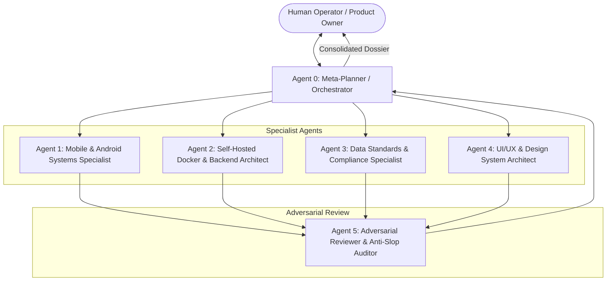
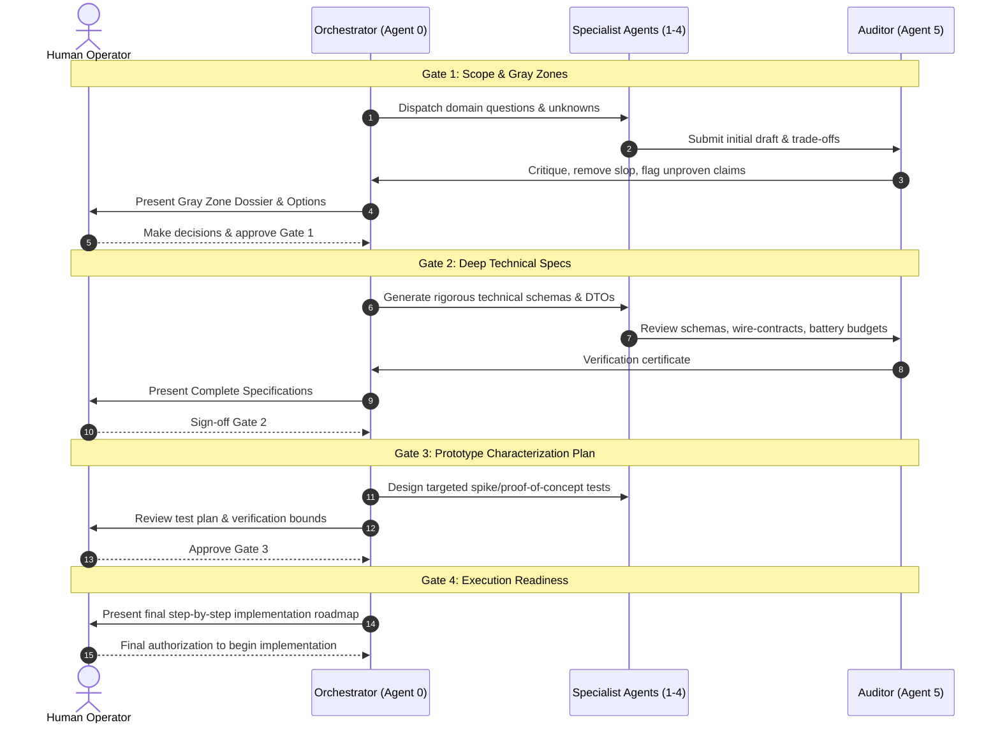

# MileWage — Master Planning Framework ("Plan for Planning")
## Multi-Agent Orchestration & Human-in-the-Loop Governance Architecture

**Project Evolution:** Comma (local-first earnings tracker, separate repo, untouched) &rarr; **MileWage** (new repo: mileage-tracking phone companion + self-hosted Docker server that holds all data)  
**Document Classification:** Meta-Planning Protocol & Multi-Agent Standard Operating Procedure (SOP)  
**Status:** ACTIVE PLANNING ARCHITECTURE  
**Strict Policy:** Zero Execution Code without explicit Human-in-the-Loop Sign-Off at every Phase Gate.

---

## 1. Executive Vision & Problem Statement

### 1.1 The Shift from Comma to MileWage
Comma was conceived as an offline-first, client-side earnings tracker that stored data strictly on-device and optionally synced an encrypted vault to Google Drive. MileWage is a separate product with a different architecture: the self-hosted server is the single source of truth (decision 1.5, see `06`). Drivers and gig workers need more than Comma offers:
1. **Continuous Telemetry & Estimated Deadhead Split**: High-fidelity GPS tracking, live trip calculation, auto-detected stops, and an estimated (never driver-tapped) deadhead vs active mileage split.
2. **Self-Hosted Autonomy**: True self-hosted ownership via Docker. A driver or courier can host their own **MileWage Web Application** on a homelab, Raspberry Pi, or cheap VPS, retaining 100% data custody without third-party cloud lock-in (Google Drive or Big Tech APIs).
3. **Enterprise & Industry Data Standards**: Seamless, audit-proof data handovers (IRS / CRA / HMRC standard mileage logs, standard accounting imports, GeoJSON/GPX tracks, open telemetry specs).
4. **Cohesive UI / Design Language**: A unified, distraction-free, native-feeling design system across both the mobile tool and the self-hosted web console.

### 1.2 The Anti-Slop Charter
AI agents left unconstrained frequently introduce "slop": speculative features, bloated dependencies, generic dashboard widgets nobody asked for, hallucinated edge cases, and code that ignores real-world mobile battery constraints.

**The MileWage Anti-Slop Principles:**
1. **Human-in-the-Loop at Every Gate**: An agent must *propose and substantiate* — the human operator must *validate and confirm*.
2. **Driver Grounding**: Every feature must answer a real driver problem: *Does this save me money on taxes, accurately capture my miles, protect my phone battery, or safeguard my privacy?* If the answer is no, it is deleted.
3. **No Phantom Architecture**: Every proposed component must be accompanied by resource consumption limits (CPU, RAM, network, battery impact).
4. **Server Is the Final Source of Truth**: One authoritative copy of the data, on the driver's own server. The phone is a working local app that keeps its own data until the server confirms it (decision 1.5a, specs `14` and `15`), and the server's numbers win on any difference. No local-first sync engine, no silent desync by construction. Comma's lessons (country registry, tax/mileage logic, design system, onboarding) are copied across deliberately and re-verified, not shared.
5. **Diagnostics Stay Home**: built-in diagnostics for testing, debugging and improving go only to the driver's own server (decision 1.5c, `16`): no third-party SDKs, and never a coordinate, address, payout, label or free text. Terminology: "telemetry" in these plans means the GPS breadcrumbs; "diagnostics" means how the app, the engine and the server behaved.


## 1.3 The Modularity Rule (IMPORTANT — applies to every plan, every gate)

MileWage is **modular from the ground up**. Any capability should be switchable on or off, or replaceable, without reworking the rest of the system.

1. **Module boundary:** Every capability (tracking, stops, route replay, each export format, each country's tax rules, auth, backup targets, storage, map tiles, notifications, diagnostics) is a module with a named public interface. No module imports another module's internals.
2. **Toggle by configuration:** Every optional module has a config switch and a documented default. Turning it off removes its routes, screens and background jobs, and nothing else breaks.
3. **Attach, don't edit:** Adding a new export format, country, delivery platform or backup target means adding a module and registering it, not changing existing modules.
4. **Swappable at the seams:** Storage sits behind a repository interface (so SQLite could later become Postgres), and the phone's location source sits behind a tracker interface (so iOS can get its own native module). The same applies to anything else with a plausible replacement.
5. **Contracts first:** Modules talk through typed interfaces or events defined in the shared package, and the API and schema keep optional modules in their own routes and tables.
6. **Every spec states it:** Each plan document from Gate 2 on has a **Modularity** section listing its modules, each one's interface, dependencies, toggle and how it is removed.
7. **Balance with anti-slop:** Put a boundary where a real toggle or swap is plausible. Do not add abstraction layers for imagined futures. Agent 5 audits both failures: a missing boundary and a pointless one.

---

## 2. Multi-Agent Planning Team Structure

Planning MileWage is too multifaceted for a single agent context. It is partitioned across specialized agent personas, each with a defined domain, strict inputs/outputs, and an adversarial peer-review mandate:



| Agent Role | Domain Responsibilities | Primary Deliverables |
|---|---|---|
| **Agent 0: Orchestrator** | Enforces the planning meta-framework, routes inquiries, coordinates agent tasks, and interfaces with the human operator. | `README.md`, Master Schedule, Gate dossiers. |
| **Agent 1: Mobile Systems** | Android foreground service, fused GPS algorithms, battery kill defenses, local SQLite buffering, Bluetooth car-detection. | `02-mobile-architecture-plan.md` |
| **Agent 2: Docker & Backend** | Docker Compose topology, API surface (Fastify/TypeScript), database schema (SQLite), resource footprints, backup/restore. | `03-self-hosted-docker-architecture-plan.md` |
| **Agent 3: Standards & Handover** | IRS/CRA/HMRC compliance, GeoJSON/GPX spatial export formats, CSV/JSON accounting bridges. | `04-data-standards-and-handovers-plan.md` |
| **Agent 4: UI & Design System** | Extending Comma's dark/light design system, desktop & mobile web responsiveness, typography (DM fonts), MapLibre map integration. | `05-design-system-and-ui-plan.md` |
| **Agent 5: Anti-Slop Auditor** | Challenges assumptions, identifies over-engineering, checks battery/RAM budgets, and flags unvetted complexity. | Audit sections across all plans. |

---

## 3. Directory Blueprint

```
plans/milewage/
├── README.md                                  ← This Master Meta-Planning Architecture
├── 00-agents-and-responsibilities.md          ← Team charter, handoff protocols, and agent prompts
├── 01-core-vision-and-scope.md                ← Product vision, non-negotiables, naming migration
├── 02-mobile-architecture-plan.md             ← Android telemetry engine, offline queue, GPS specs
├── 03-self-hosted-docker-architecture-plan.md ← Docker Compose, API contracts, DB, backup specs
├── 04-data-standards-and-handovers-plan.md    ← Tax audit standards (IRS/CRA), GPX/GeoJSON exports
├── 05-design-system-and-ui-plan.md            ← UI tokens, layout guidelines, web dashboard UX
├── 06-human-in-the-loop-review-gates.md       ← Step-by-step gate checklists & sign-off rubrics
├── 07-database-schema-spec.md                 ← SQLite schema, mileage rules, retention (Gate 2)
├── 08-api-spec.md                             ← API, auth, offline upload contract, OpenAPI 3.1, modules (Gate 2)
├── 09-background-gps-decision.md              ← Android tracking engine decision and Spike A criteria (Gate 2)
├── 10-backup-restore-and-ops-spec.md          ← Backup, restore, networking, ops, Spike B plan (Gate 2)
├── 11-gate2-audit-and-decisions.md            ← Gate 2 dossier: decisions, audit changes, unverified claims
├── 12-gate3-spike-plan.md                     ← Gate 3 slim spike plan (S0 done; B, D, A with C folded in)
├── 14-phone-processing-spec.md                ← Shared track-engine: how phone and server compute the same totals (1.5a)
├── 15-offline-storage-and-sync-spec.md        ← Phone local storage, weeks-offline sync, reconciliation, conflicts (1.5a)
├── 16-diagnostics-and-telemetry-spec.md       ← Built-in diagnostics (own server only), capture sessions, debug view (1.5c)
├── 18-comma-parity.md                         ← Comma-parity driver admin modules: expenses, goals, schedule, analytics, tax, platforms, notifications (1.9)
├── 19-phone-connection-tailscale.md           ← Phone reaches the home server over Tailscale https: fixes, install step, clearer errors (1.7)
├── infra-requirements.md                      ← Hardware, VM and account facts for the spikes (from the infra agent)
└── spikes/                                    ← Spike results (S0 done); `13-gate3-results-and-decisions.md` is written when Gate 3 closes
```

---

## 4. Multi-Stage Planning Workflow (The 5 Gates)

Every agent follows this strict sequence before execution can even be proposed:



---

## 5. Next Immediate Step

Review [`00-agents-and-responsibilities.md`](./00-agents-and-responsibilities.md) and [`06-human-in-the-loop-review-gates.md`](./06-human-in-the-loop-review-gates.md) to inspect the multi-agent operating rules and initial Gate 1 questions.

